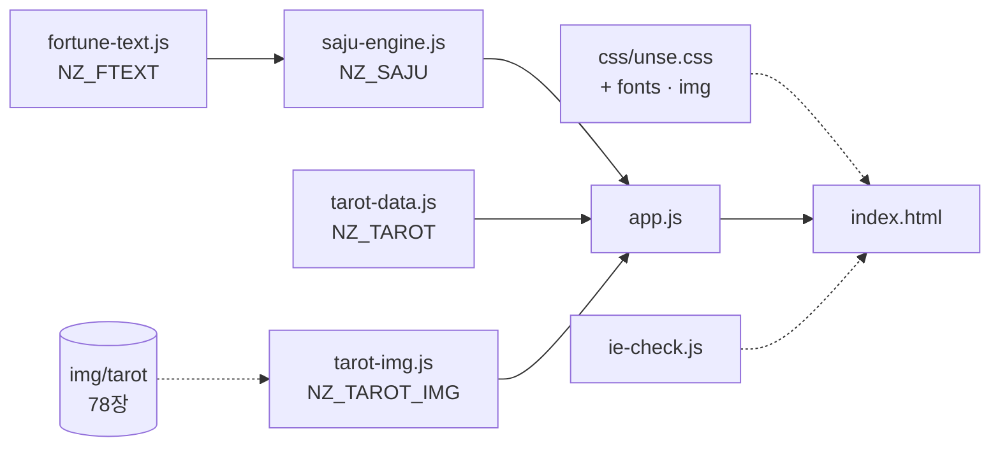
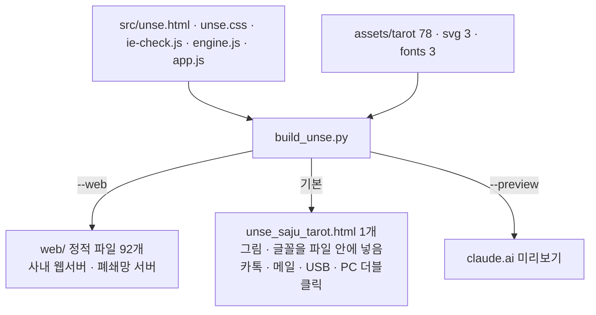
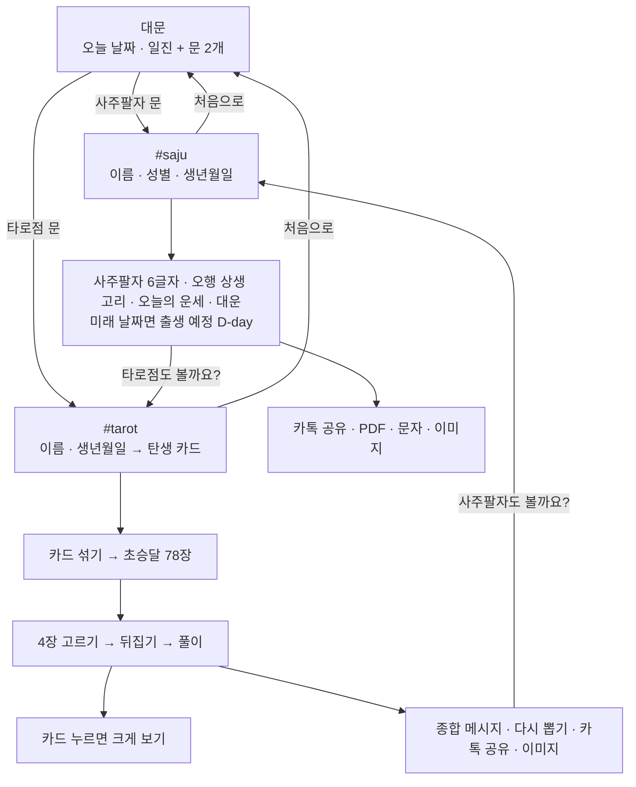
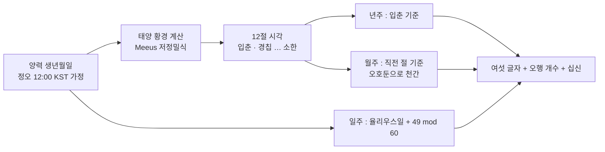
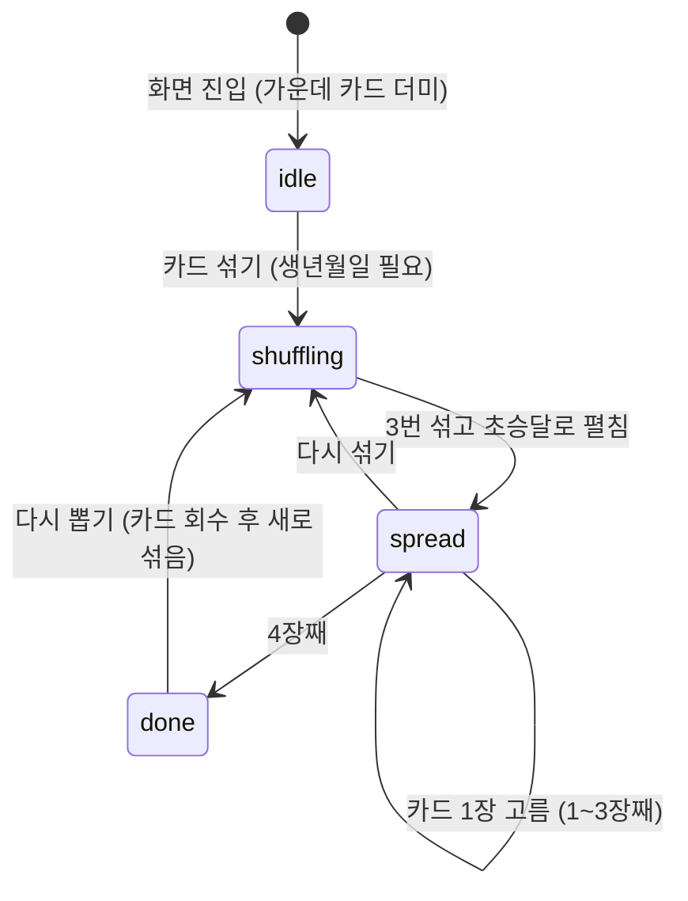

# 오늘의 운세 v2 (사주팔자 · 타로) 개발 설계도

> 세일즈혁신TF · 2026-10-29 · 탑재 방법은 `README.md`, 코드 원문은 `SOURCE_ALL.md`, 파일 목록과 해시는 `MANIFEST.txt`
> v1 설계도(2026-10-16)의 장 구성을 이어받고, v2 에서 바뀐 곳(카드 그림 · 디자인 · 배포 방식)을 더했다.

## 1. 한눈에 보기

| 항목 | 내용 |
|---|---|
| 무엇 | 대문에서 **사주팔자** / **타로점** 중 하나를 골라 들어가는 운세 웹페이지 (재미용 고객 대화 도구) |
| 판 | **웹서버판** `web/` 정적 파일 92개 · 2.6MB / **한 파일판** `unse_saju_tarot.html` 1개 · 3.5MB (같은 원본에서 조립) |
| 서버 | **필요 없음.** 정적 파일만 내려주면 됨 (DB · API · 로그인 · 서버 코드 없음) |
| 인터넷 | **필요 없음.** 외부 CDN · 웹폰트 서버 · 분석 도구 · API 호출 0건 → 폐쇄망 · 사내망 · 오프라인 동작 |
| 보안정책(CSP) | 인라인 스크립트 · 인라인 스타일 · `style=""` 속성 · `data:` 주소 · 외부 주소 · `eval` 0건 (웹서버판) |
| 개인정보 | 이름 · 생년월일은 브라우저 메모리에서만 계산. 저장 · 전송 없음 (쿠키 · localStorage · 서버 기록 없음) |
| 지원 브라우저 | 엣지 · 크롬 88 이상, 사파리 iOS 15 이상, 삼성 인터넷 15 이상. 익스플로러는 엣지로 넘김 |
| 날짜 범위 | 양력 1936-01-01 ~ 2046-12-31 (오늘 이후는 '출생 예정'으로 처리) |
| v1 과의 차이 | **화면 · 그림 · 글꼴만 바뀜.** 사주 계산 · 운세 문구 · 타로 풀이 코드는 v1 웹 패키지와 한 글자도 같다 (파일 맨 위 설명 줄만 다름) |

## 2. 파일 구성 (웹서버판)

```
web/                       (zip 안에서는 unse/)
├─ index.html              화면 뼈대 (대문 · 사주 · 타로 3개 <section> + 카드 크게 보기 창)
├─ css/unse.css            모든 디자인 · 애니메이션 · 인쇄(PDF) 스타일 · 글꼴 선언
├─ js/ie-check.js          익스플로러 감지 → 엣지로 다시 열기 (<head> 에서 가장 먼저)
├─ js/fortune-text.js      window.NZ_FTEXT   사주 운세 문구 표          (v1 과 같음)
├─ js/saju-engine.js       window.NZ_SAJU    사주 계산 엔진             (v1 과 같음)
├─ js/tarot-data.js        window.NZ_TAROT   타로 78장 데이터 · 자리    (v1 과 같음)
├─ js/tarot-img.js         window.NZ_TAROT_IMG  카드 그림 주소 78개 (img/tarot/00~77.webp)
├─ js/app.js               화면 이동 · 사주 화면 · 타로 연출 · 크게 보기 · 저장/공유
├─ img/card-back.svg       타로 뒷면 (남색 · 금선 해 · 달 · 별, 180도 대칭)
├─ img/hanji.svg           사주 화면 한지 결 무늬
├─ img/zoom.svg            풀이 카드 '크게 보기' 돋보기
├─ img/tarot/00~77.webp    카드 앞면 그림 78장 (1909년 라이더-웨이트-스미스 원판, 286×484)
├─ fonts/serif-ko.woff2    고운바탕 Bold (한글 2,350자 + 화면 글자)
├─ fonts/hanja.woff2       Noto Serif KR 700 (사주 한자 31자)
└─ fonts/cinzel.woff2      Cinzel 700 (로마 숫자 · 영문 카드 이름)
```

| 종류 | 개수 | 크기 |
|---|---:|---:|
| HTML · CSS · JS | 8 | 약 157KB |
| SVG | 3 | 약 6KB |
| 카드 그림 WebP | 78 | 약 2.4MB |
| 글꼴 WOFF2 | 3 | 약 187KB |
| **합계** | **92** | **약 2.6MB** |

스크립트는 아래 순서대로 읽어야 한다 (`app.js` 가 앞의 네 전역 객체를 씀). 빌드 도구 · 패키지 매니저 없이 그대로 배포한다.



### 2-1. 원본과 조립

웹서버판 · 한 파일판 · 미리보기판은 **같은 원본**(`fortune/src`, `fortune/assets`)에서 `fortune/build_unse.py` 가 만든다. 그래서 두 판의 화면 · 계산이 항상 같다.



| 원본 | 내용 |
|---|---|
| `src/unse.html` | 화면 틀. 자리표 `<!--@@HEAD@@-->`(스크립트 · 스타일 자리) · `<!--@@SCRIPTS@@-->` |
| `src/unse.css` | 디자인. 자리표 `@@FONT_*@@` · `@@BACK@@` · `@@HANJI@@` · `@@ZOOM@@` (웹판은 파일 주소, 한 파일판은 data: 주소로 채움) |
| `src/engine.js` | 사주 엔진 + 운세 문구 + 타로 풀이. 웹판에서는 v1 과 같은 세 파일로 나눠 쓴다 |
| `src/app.js` · `src/ie-check.js` | 화면 동작 · 익스플로러 안내 |
| `tools/prep_tarot.py` | 카드 그림 손질 (원판 PNG → 테두리 · 영문 제목띠 자르기 → 286×484 WebP) |
| `tools/make_fonts.py` | 글꼴에서 필요한 글자만 남기기 (화면에 새 한자가 들어가면 다시 돌림) |

## 3. 화면 흐름

해시 주소로 화면을 바꾼다 (`#` 없음 = 대문, `#saju`, `#tarot`). 새로고침 · 뒤로가기 · 북마크가 그대로 동작한다. 한 화면에 넣은 이름 · 생년월일은 다른 화면으로 이어진다.



| 요소 | 동작 |
|---|---|
| `body.v-gate / v-saju / v-tarot` | 지금 화면. CSS 가 이 클래스로 해당 `<section class="view">` 만 보여 줌 |
| `route()` | `hashchange` 때 화면 클래스 · `theme-color` 변경, 크게 보기 창 닫기, 맨 위로, 이름 · 생년월일 이어받기 |
| 문 연출 | 누른 문이 살짝 커지고 다른 문은 사라진 뒤(0.32초) 주소 변경 |

### 생년월일 입력 (휴대폰 우선)

- 칸을 누르면 **숫자 키패드**가 뜬다 (`type="text" inputmode="numeric"`). `19900928` 처럼 숫자만 치면 `1990-09-28` 로 하이픈이 자동으로 들어간다.
- 8자리가 맞는 날짜면 키보드를 내리고 바로 계산한다. 없는 날짜 · 범위 밖 날짜는 안내 문구(토스트)를 띄운다.
- 오른쪽 **달력 아이콘** 위에 투명한 `<input type="date">` 를 겹쳐 두었다. 누르면 OS 기본 달력이 열리고, 고른 값이 칸에 채워진다.

## 4. 사주 엔진 (`saju-engine.js`) · v1 과 같음

엑셀 로직 파일의 `saju_engine.py` 와 **같은 규칙 · 같은 해시**를 쓰는 이중 구현이다. `tools/verify_saju.py` 로 1936-01-01 ~ 2046-12-31 **40,543일 전부 일치**를 2026-10-29 에 다시 확인했다.

### 4-1. 기둥 계산



| 단계 | 규칙 |
|---|---|
| 시각 | 한국 표준시(UTC+9). 태어난 시간은 받지 않고 **정오 출생**으로 본다 → 시주 없음(여섯 글자) |
| 절기 | 태양 황경이 315°(입춘), 345°(경칩) … 285°(소한)가 되는 순간을 뉴턴법으로 구함. 오차 수 분~15분 |
| 년주 | 입춘 전이면 전년. 천간 `(년-4) mod 10`, 지지 `(년-4) mod 12` |
| 월주 | 출생 시각 직전의 절 → 월지. 월간 = `(년간 mod 5)×2 + 2 + (월지-寅)` |
| 일주 | `floor(JD + 49) mod 60` (2000-01-01 = 戊午) |
| 절입일 | 출생일이 절기 당일이면 "○○ 시각 전/뒤에 태어나면 월주(입춘은 띠 · 년주)가 바뀐다"고 안내 |
| 대운 | 양년+남 · 음년+여 = 순행, 반대 = 역행. 다음(이전) 절까지 일수 ÷ 3 = 대운수(1~10) |

### 4-2. 오늘의 운세 점수

```
분야 점수 = 70 + 십신보정[분야] + 일지관계 + round(띠관계 × 0.6) + 오행균형 + 흔들기(−4~+4)
           → 55 ~ 98 로 자름
총점      = (재물×30 + 대화×25 + 일×25 + 컨디션×20 + 50) ÷ 100  (정수 나눗셈)
별        = 90↑ ★5 · 82↑ ★4 · 72↑ ★3 · 그 아래 ★2
```

| 요소 | 값 |
|---|---|
| 십신보정 | 오늘 천간이 내 일간에게 무엇인가 (비견~정인 10종) → [재물, 대화, 일, 컨디션] 보정표. 예: 정재 `[+12, +3, +5, +4]` |
| 지지 관계 | 충 −6 · 육합 +8 · 반합 +6 · 형 −4 · 원진 −3 · 해 −3 · 파 −2 · 같음 +3 · 무난 0 |
| 오행균형 | 오늘 천간 오행이 내 사주에 0개 +6(채움) · 3개↑ −4(넘침) · 그 외 +2 |
| 흔들기 | `FNV-1a(생년월일|성별|오늘)` 해시 → 같은 사람 · 같은 날은 늘 같은 점수 |
| 문구 | 같은 해시로 문구 표(`NZ_FTEXT`)에서 한 줄 · 대화 팁 선택 |
| 행운 색 · 숫자 · 방향 | 내 사주에서 가장 적은 오행 (동률이면 인성→비겁→식상→재성→관성 순) |

### 4-3. 출생 예정(미래 날짜)

생년월일이 오늘보다 뒤면 `출생 예정 D-n` 으로 표시하고, 오늘의 운세 대신 **태어날 아기의 기운**(띠 · 일간 성향 · 채워 주면 좋은 오행)을 보여 준다. 대운은 표시하되 '현재 대운' 강조는 하지 않는다.

### 4-4. 화면 표현 (v2)

| 칸 | 표현 |
|---|---|
| 사주팔자 | 일주 · 월주 · 년주 세 패. 한자는 명조(Noto Serif KR), 칸 색 = 오행(木 초록 · 火 빨강 · 土 황토 · 金 회색 · 水 남색), 아래에 한글 읽기와 오행(예: 火·金). 일주(나)는 금테 |
| 오행 분포 | **상생 고리 그림** (SVG). 木(위)부터 시계 방향 火 · 土 · 金 · 水, 바깥 원 화살표 = 상생, 안쪽 점선 별 = 상극. 동그라미 크기 = 글자 수(0개는 점선 · 흐리게), 가운데 = 일간 |
| 운세 점수 | 금색 → 보라 그러데이션 고리, 별 5개, 한 줄 문구는 명조 |
| 대운 | 가로로 미는 칸. 지금 나이의 대운은 남색 칸 |

## 5. 타로 (`tarot-data.js` + `app.js`)

### 5-1. 데이터 · v1 과 같음

```js
{ id: 0~77, major: true|false, no: 0~21(메이저), suit: 0~3, rank: 0~13(마이너),
  ko: '정의', en: 'Justice', sym: '⚖️'(v1 화면용, v2 는 쓰지 않음),
  up: ['공정·균형·책임', '정방향 풀이 문장'], rv: ['불공정·편향', '역방향 풀이 문장'] }
```

| 구분 | 내용 |
|---|---|
| 메이저 아르카나 22장 | 0 바보 ~ XXI 세계 (라이더-웨이트 순서, 힘 VIII · 정의 XI) |
| 마이너 아르카나 56장 | 완드(불 · 일), 컵(물 · 관계), 소드(공기 · 생각), 펜타클(흙 · 돈) × 에이스 · 2~10 · 시종 · 기사 · 여왕 · 왕 |
| 풀이 | 78장 × 정/역 = 156개, 해요체 한두 문장 + 키워드 |
| 자리(4장) | ① 지금의 나 ② 걸림돌 ③ 도움의 열쇠 ④ 다가올 흐름 |
| 탄생 카드 | 생년월일 숫자를 모두 더해 22 이하가 될 때까지 다시 더함 (22 → 0 바보) |

### 5-2. 카드 그림 (v2)

| 항목 | 내용 |
|---|---|
| 출처 | 라이더-웨이트-스미스 타로 **1909년 원판** (아서 에드워드 웨이트 기획 · 파멜라 콜먼 스미스 그림). 스미스 1951년 사망 → 사후 70년 지난 **공개 저작물**. 1909년 원판 색을 쓴 npm 꾸러미 `@cometpisces/tarot-kit-images@0.2.0` 에서 받음 |
| 쓰지 않는 것 | 1971년 U.S. Games 재채색판(카드 아래 ⓒ 표시가 있는 판) |
| 손질 | 바깥 테두리 · 그림 외곽선 7px 자름 → 아래 영문 제목띠(메이저 · 에이스 · 궁정 카드) 자름 → 같은 비율 286×484 로 맞춤 → 채도 +8% · 대비 +4% → WebP 품질 76 |
| 번호 | `img/tarot/NN.webp` 의 NN = 데이터 `id` (0~21 메이저, 22부터 완드 · 컵 · 소드 · 펜타클 14장씩) |
| 결정 | 「죽음」 · 「소드 10」 · 맨몸 인물 카드도 **원판 그대로 쓴다** (소유자 2026-10-29) |

카드 한 장은 폭 `--w` 하나로 모든 치수가 정해진다 (실제 타로 70×120mm 비율).

```
카드      폭 w × 높이 1.72w, 모서리 0.055w, 크림색 종이 그러데이션 + 금박 선(안쪽 0.028w)
그림 창   테두리 0.06w 안쪽, 폭 0.88w × 높이 0.88w × 1.6923 (= 286:484)
이름판    나머지 아래 칸. 한글 이름 명조 0.125w (5~6자 0.108w, 7자↑ 0.094w)
          크게 보기에서는 영문 이름(Cinzel)도 함께
역방향    카드 전체를 180° 돌림 (이름판도 거꾸로 = 실제 카드 방식)
뒷면      img/card-back.svg (100:172), 180° 돌려도 같은 무늬
```

### 5-3. 상태



`TT.lock` 이 연출 중 클릭을 막아 두 장이 동시에 날아가지 않게 한다.

### 5-4. 무작위

- 섞을 때마다 `crypto.getRandomValues` 로 78장 순서를 피셔-예이츠 셔플 (편향 없는 거부 샘플링). 없으면 `Math.random`.
- k번째로 누른 카드 = 섞인 순서의 k번째 카드 → **어느 위치를 눌러도 결과는 매번 새로 무작위**.
- 정/역방향은 장마다 50% 확률.

### 5-5. 초승달 배치 좌표

```
자리 카드 폭  sw = min(92, (W − 54) ÷ 4),  높이 sh = sw × 1.72
펼침 크기    k0 = 0.54 (자리 카드 대비),  양 끝 최소 배율 smin = 0.4,  펼침 각도 ±74°
반지름        R = (W/2 − 8) ÷ sin74° − sh·k0·smin
i번째 카드   t = i ÷ (n−1),  a = −74° + 148°·t,  s = smin + (1−smin)·sin(πt)
             길이 L = sh·k0·s,  중심 = (W/2 + (R+L/2)·sin a,  cy − (R+L/2)·cos a),  회전 a,  배율 k0·s
```

### 5-6. 애니메이션 순서

| 단계 | 시간 | 내용 |
|---|---|---|
| 섞기 | 0.62초 × 3회 | 짝수 · 홀수 카드가 좌우로 갈라졌다(±9°) 다시 합쳐짐 |
| 펼치기 | 0.7초 + 장당 9ms | 왼쪽 끝부터 차례로 초승달 자리로 |
| 올려 보기 | 0.18초 | (마우스) 카드가 바깥쪽으로 16% 올라오고 금색 테두리 |
| ① 들림 | 0.23초 | 누른 카드가 바깥으로 34px, 1.3배 |
| ② 이동 | 0.64초 | 자리 k 로 날아감. 동시에 남은 카드가 빈자리를 메우며 재정렬 |
| ③ 뒤집기 | 0.6초 | `rotateY(180deg)`, 역방향은 앞면을 180° 돌려 둠 |
| ④ 공개 | 1.3초 | 금빛 테두리 + 카드 위를 지나가는 빛(한 번) + 자리 아래 정/역 표시 + 풀이 등장 |
| 완료 | · | 남은 카드는 흐리게, 종합 메시지로 스크롤 |

모든 움직임은 CSS `transform` 이라 GPU 로 그린다. '동작 줄이기'(`prefers-reduced-motion`)면 연출 없이 결과를 바로 보여 준다.

### 5-7. 종합 메시지 규칙 · v1 과 같음

| 조건 | 문장 |
|---|---|
| 메이저 2장 이상 | 오늘 일은 오래 · 크게 영향을 준다 |
| 메이저 1장 | 그 카드가 중심 메시지 (정: 기운을 믿고 / 역: 기울지 않게) |
| 메이저 0장 | 일상의 작은 선택이 쌓이는 날 |
| 같은 수트 2장 이상 | 수트별 원소 문장 (불 · 물 · 공기 · 흙) |
| 역방향 0 / 1~2 / 3~4장 | 막힘 없음 / 살짝 엇박자 / 속도를 늦출 때 |
| 탄생 카드가 나옴 | "나다움이 가장 큰 무기" (안 나오면 탄생 카드의 힘을 떠올리라는 문장) |
| 한 줄 | ③ 열쇠 카드 키워드 + ④ 흐름 카드 키워드로 조합 |

### 5-8. 카드 크게 보기 (v2)

풀이 카드 · 종합 메시지의 카드 · 무대 위 뽑은 카드를 누르면 큰 카드(폭 130~230px)와 자리 · 이름(한글 · 영문) · 정/역 · 키워드 · 풀이를 띄운다. `role="dialog"` · `aria-modal`, 열리면 '닫기'에 초점, Esc · 바깥 누르면 닫히고 초점은 원래 자리로 돌아간다.

## 6. 디자인 (v2)

| 화면 | 바탕 | 상징 |
|---|---|---|
| 대문 | 밤하늘(남색 그러데이션 + 별) | 금색 달 문장 · 사주 문(일월오봉 + 「四柱八字」 낙관) · 타로 문(실제 카드 3장 부채꼴) |
| 사주 | 한지(아이보리 + 결 무늬) | 머리에 **일월오봉도**(왼쪽 달 · 오른쪽 해 · 다섯 봉우리 · 물결) 금선 그림 |
| 타로 | 밤하늘 | 남색 · 금선 카드 뒷면, 크림색 카드 앞면 |

| 토큰 | 값 | 쓰임 |
|---|---|---|
| `--night` · `--night2` | #0d0826 · #170f3d | 대문 · 타로 바탕 |
| `--gold` · `--gold-hi` · `--gold-lo` | #e8c77a · #f8e7b4 · #b8913f | 강조색 하나 (금) |
| `--paper` · `--card` · `--pline` | #f4efe4 · #fffdf8 · #e7ddc8 | 사주 한지 바탕 · 카드 · 선 |
| `--ink` · `--sub` · `--mute` | #1c1730 · #4b4560 · #6b6580 | 글자 (대비 4.5:1 이상) |
| `--e0`~`--e4` | #2f9e62 · #e0402f · #b67d00 · #5f6873 · #2b4a8b | 오행 다섯 색 (사주 글자에만) |

| 글꼴 | 쓰임 | 막혔을 때 |
|---|---|---|
| 고운바탕 Bold (`UnseSerif`) | 한글 제목 · 카드 이름 · 사람 이름 | AppleMyungjo · Nanum Myeongjo · 바탕 |
| Noto Serif KR 700 (`UnseHan`) | 사주 한자 | AppleMyungjo · 바탕 |
| Cinzel 700 (`UnseCinzel`) | 로마 숫자 · 영문 | Georgia |
| 본문 | 시스템 글꼴 (Pretendard 가 깔려 있으면 Pretendard, 윈도우는 맑은 고딕) | · |

접근성 : 작은 글씨 대비 4.5:1 이상, 누르는 것 44px 이상(뒤로 · 성별 · 버튼), 모든 단추 키보드 초점 표시, **키보드만으로 타로 진행**(카드 자리에서 Enter = 섞기 · 한 장 뽑기 · 크게 보기), 그림 카드에 이름 읽기(`role="img"` + `aria-label`), 결과 영역 `aria-live`.

## 7. 공유 · 저장

| 버튼 | 방식 | 인터넷 |
|---|---|---|
| 카톡으로 보내기 (사주) | 캔버스로 1080×1350 이미지(밤하늘 + 일월 + 사주 세 패 + 한지 카드)를 그려 Web Share(파일+글) → 공유창에서 카카오톡. 미지원이면 글 복사 | 불필요 |
| 카톡으로 보내기 (타로) | 캔버스로 **실제 카드 그림 4장**(역방향은 거꾸로) + 자리 · 정/역 + 한 줄 점괘 + 장별 풀이 (가로 1080, 세로는 내용에 맞춤 약 1570). 미지원 PC 는 PNG 저장 + 글 복사 | 불필요 |
| 이미지로 저장 | 위 이미지를 공유창(휴대폰) 또는 PNG 다운로드(PC) | 불필요 |
| PDF로 저장 | `window.print()` + 인쇄 전용 CSS (A4 한 장 2단) | 불필요 |
| 문자로 보내기 | `sms:번호?body=` (iOS 는 `&body=`) | 불필요 |

- 카드 그림은 같은 출처 파일(웹판) 또는 파일 안의 그림(한 파일판)이라 캔버스가 오염되지 않아 PNG 로 내보낼 수 있다.
- **예외** : 웹서버판 폴더를 서버 없이 파일(`file://`)로 열면 브라우저가 그림 넣은 캔버스 저장을 막는다. 이때는 카드 그림만 빼고(틀 · 이름 · 점괘는 그대로) 저장한다. 서버 없이 쓸 때는 한 파일판을 쓰면 그림까지 저장된다.
- 휴대폰 번호만으로 카카오톡을 직접 보내려면 알림톡(비즈 API, 서버) 연동이 필요하다. 이 패키지 범위 밖이다.

## 8. 보안 · 개인정보

- 네트워크 요청은 **같은 폴더의 정적 파일 92개뿐**이다. `fetch` · `XMLHttpRequest` · WebSocket · 외부 이미지 · 외부 글꼴이 없다.
- 입력값은 메모리에서만 계산하고, 화면을 닫으면 사라진다 (쿠키 · localStorage · sessionStorage · IndexedDB 미사용).
- 화면에 넣는 사용자 입력(이름)은 HTML 이스케이프 처리한다.
- 그림 · 무늬는 모두 파일(`img/`)이고, 글꼴도 파일(`fonts/`)이다. CSS · JS 안에 `data:` 주소가 없다 (웹판).
- 아래 정책으로 시험해 **위반 0건**을 확인했다 (`tools/csp_test_server.py`, `tools/check_web.js`).

```
default-src 'none'; script-src 'self'; style-src 'self'; img-src 'self' blob:; font-src 'self';
connect-src 'none'; frame-ancestors 'self'; base-uri 'none'; form-action 'none'
```

| 지시어 | 왜 필요한가 |
|---|---|
| `img-src blob:` | '이미지로 저장' 때 만든 PNG 를 내려받는 주소 |
| `font-src 'self'` | `fonts/` 의 글꼴 3개. 회사 정책이 글꼴을 막으면(`font-src 'none'`) 기본 글꼴로 나오고 기능은 그대로 (시험 완료) |
| `frame-ancestors 'self'` | 같은 사이트 안에서만 iframe 으로 넣을 수 있음. 다른 도메인 포털에 넣으려면 그 도메인을 추가 |

v1 (2026-10-16) 정책과 다른 점은 `font-src 'none'` → `'self'` 하나다 (v2 는 글꼴 파일을 함께 내려줌).

## 9. 배포 방식

| 방식 | 쓰는 판 | 언제 | 메모 |
|---|---|---|---|
| A. 사내 웹서버 단독 페이지 (권장) | `web/` | 포털 메뉴 · 배너 링크 | `/unse/`, `/unse/#saju`, `/unse/#tarot` |
| B. 포털 페이지 안 iframe | `web/` | 기존 화면 안에 끼우기 | `allow="clipboard-write; web-share"`, 포털 쪽 정책에 `frame-src 'self'` |
| C. 사내 앱 웹뷰 | `web/` | 앱 안 메뉴 | 웹뷰가 Web Share 미지원이면 이미지 저장 + 글 복사로 바뀜 |
| D. 파일 전달 · 폐쇄망 PC | 한 파일판 | 카톡 · 메일 · USB · 서버 없는 PC | 더블클릭으로 열림. 그림 · 글꼴이 파일 안에 있어 저장 이미지에 카드 그림까지 들어감 |

### 서버 설정

| 항목 | 값 |
|---|---|
| MIME | `.html` text/html · `.css` text/css · `.js` application/javascript · `.svg` image/svg+xml · **`.webp` image/webp** · **`.woff2` font/woff2** |
| 문자 인코딩 | UTF-8 (모든 텍스트 파일 UTF-8, `index.html` 에 `<meta charset="utf-8">`) |
| 캐시 | `index.html` 은 no-cache, 나머지는 길게 캐시해도 됨 (바꿀 때 파일 이름이 아니라 내용을 바꾸므로 배포 후 캐시 비우기 권장) |
| HTTPS | 권장. 휴대폰 **공유(카톡으로 보내기) · 클립보드 복사**는 HTTPS(또는 localhost)에서만 동작 |
| 압축 | WebP · WOFF2 는 이미 압축됨. HTML · CSS · JS 는 gzip 압축하면 약 50KB |

> 오래된 IIS 는 `.webp` · `.woff2` MIME 이 없어 404 를 낸다. `web.config` 의 `<staticContent>` 에 두 줄 추가가 필요하다 (`README.md` 참고).

## 10. 검증 기록 (2026-10-29)

| 항목 | 결과 |
|---|---|
| 사주 엔진 JS ↔ 파이썬 | 1936-01-01 ~ 2046-12-31, **40,543일** × (년 · 월 · 일주 · 절입 · 대운 남/여 · 총점 · 분야 점수 · 문구 · 팁 · 띠 문장) **불일치 0** (웹판 3파일, 원본 engine.js 둘 다) |
| v1 화면 ↔ v2 화면 | 날짜 120개 × 남녀 = 240건 사주 칸 값(기둥 · 십신 · 절기 경고 · 문구 · 점수 · 행운 · 대운) **차이 0** |
| v1 웹 패키지 ↔ v2 웹판 계산 파일 | `fortune-text.js` · `saju-engine.js` · `tarot-data.js` 본문 **동일** (맨 위 설명 줄만 다름) |
| 엄격한 CSP 아래 동작 | 대문 → 사주(입력 · 결과 · 이미지 저장) → 타로(섞기 · 4장 · 크게 보기 · 이미지 저장) **위반 0 · 콘솔 오류 0** |
| 글꼴까지 막는 CSP | 글꼴 3개만 막히고 기본 글꼴로 표시, 기능 정상 |
| 네트워크 | 같은 출처 정적 파일 외 요청 **0건** |
| iframe | 같은 사이트 포털 페이지 안에서 타로 4장까지 정상 |
| 파일로 열기(`file://`) | 웹판 폴더 : 화면 · 풀이 정상, 이미지는 카드 그림 빼고 저장 / 한 파일판 : 전부 정상 |
| 화면 폭 | 320px · 390px · 400px(휴대폰), 1100px(PC). 가로 흔들림 없음 |
| 키보드 · 동작 줄이기 | 키보드만으로 타로 끝까지 · 크게 보기 Esc 닫기, 동작 줄이기에서도 오류 0 |
| 인쇄 | 사주 결과 A4 한 장 2단 |
| 미확인 | 실제 아이폰 · 갤럭시 실기기, 카카오톡 인앱 브라우저, 회사 실제 서버 · 실제 포털 정책 |

다시 돌리는 법은 `README.md` 의 '동작 확인' 장에 있다.

## 11. 고칠 때 어디를 보나

| 바꾸고 싶은 것 | 원본 파일 · 위치 |
|---|---|
| 사주 운세 문구 | `src/engine.js` 의 `NZ_FTEXT` (파이썬 쌍둥이 `tools/ref/fortune_text.py` 도 같이) → `tools/verify_saju.py` |
| 점수 공식 · 가중치 | `src/engine.js` 의 `TEN_MOD`, `REL`, 총점식 + `tools/ref/saju_engine.py` 같이 수정 → `verify_saju.py` |
| 타로 풀이 · 자리 이름 | `src/engine.js` 의 `MAJOR`, `MINOR`, `POS`, `SUIT_SUM` |
| 카드 그림 | `assets/tarot/NN.webp` 교체 (286×484 권장) 또는 `tools/prep_tarot.py` 로 다시 손질 |
| 카드 뒷면 · 무늬 | `assets/svg/card-back.svg` · `hanji.svg` · `zoom.svg` |
| 색 · 글꼴 · 간격 | `src/unse.css` 맨 위 `:root` 토큰 |
| 화면 글 · 배치 | `src/unse.html` |
| 초승달 모양 · 연출 속도 | `src/app.js` `geom()` 의 `k0` · `smin` · `amax`, `shuffle()` · `pick()` 의 `wait()` |
| 날짜 범위 | `src/app.js` `MIN_D` · `MAX_D` + `src/unse.html` 달력 `min` · `max` |

고친 뒤 순서 :

```
python3 fortune/build_unse.py                       # 한 파일판 → dist/unse_saju_tarot.html
python3 fortune/build_unse.py --web <폴더>           # 웹서버판
python3 fortune/tools/verify_saju.py                # 계산을 고쳤다면 (40,543일 대조)
node fortune/tools/check_web.js <웹판 폴더>          # 엄격한 CSP · 바깥 요청 · iframe 점검
python3 fortune/build_package.py                    # 이 패키지 zip 다시 만들기
```

> 사주 엔진 · 문구 · 타로 풀이(`engine.js`)는 v1 그대로 두는 것이 원칙이다. 고친다면 파이썬 쌍둥이를 같이 고치고 40,543일 대조를 통과시킨다.

## 12. 알려진 제약

- 태어난 시간을 받지 않으므로 시주(時柱)가 없고, 절기 당일 출생은 정오 기준으로 판정한다 (화면에 안내).
- 절기 시각은 천문 저정밀식이라 한국천문연구원 공표 시각과 수 분 차이가 날 수 있다.
- 년주 · 띠는 입춘 기준이라 음력 설 기준인 생활 속 띠와 1~2월생은 다를 수 있다. 양력 생일만 받는다.
- 타로 그림은 1909년 원판 그대로라 「죽음」(해골) · 「소드 10」 · 「탑」 · 「악마」, 몇몇 카드의 맨몸 인물이 나온다 (소유자 결정으로 유지).
- 아이폰 카카오톡 미리보기는 계산 기능(JS)을 막는다 → '사파리로 열기' 안내가 뜬다. 파일보다 **웹 링크 배포**가 가장 매끄럽다.
- 재미로 보는 콘텐츠이며, 보험 권유 · 의사결정 근거로 쓰지 않도록 화면 하단에 안내한다.

## 13. 변경 이력

| 날짜 | 판 | 내용 |
|---|---|---|
| 2026-10-13 | 로직 엑셀 | 사주 만세력 · 운세 로직 (1936-01-01 ~ 2026-10-13 하루 1행) |
| 2026-10-14 | v0 | 오늘의 사주 한 파일판 52KB + 설계도 PPT 14장 |
| 2026-10-16 | v1 | 대문 + 타로 78장 추가, 웹 탑재 패키지(정적 파일 9개 · 약 120KB), 엄격한 CSP 위반 0 |
| 2026-10-29 | **v2** | 디자인 고도화 : 1909년 원판 타로 그림 78장 · 새 카드 뒷면 · 크게 보기 · 일월오봉 · 한지 · 오행 상생 고리 · 글꼴 3종. 계산 · 문구 · 풀이 동일(40,543일 대조). 가로 흔들림 수정, 접근성 보강, 웹판 정적 파일 92개 · 약 2.6MB |
