# MeAI 홈 넛지 플레이 v5 개발 설계도 (v5.1 행운 존 포함)

> 세일즈혁신TF · 2026-10-29 (v5.1 : 행운 존 · OX 문제 은행 · 오늘의 운세 연결) · 대상 : MeAI 홈 화면(React) 개발 담당 · 넛지 서버(API · DB · 배치) 개발 담당 · 데이터 담당
> 기획 근거 : 「MeAI홈 넛지플레이 기획안 v3」(2026-10-06, 28장) · 목업 v3/v4. 이 문서는 v5 고도화 목업(`mockup/meai_home_nudge_v5.html`)을 그대로 만들기 위한 설계도다.
> 함께 보는 파일 : API 명세 `docs/openapi.yaml` · 표 정의 `docs/schema.sql` · 사용 기록 정의 `docs/EVENTS.md` · 홈 연동 방법 `docs/INTEGRATION.md` · 규칙 기준 구현 `src/core/rules.js` · 테스트 벡터 `tests/vectors.json`

## 1. 한눈에 보기

| 항목 | 내용 |
|---|---|
| 무엇 | MeAI 홈 인사말 아래 **「오늘의 MeAI」 막대 한 줄**과 머리 띠의 **내 기록 캡슐**을 더해, 출석 · 퀴즈 · 화법 · 퀘스트 · 로또 · 리그로 매일 홈을 열 이유를 만든다 |
| 왜 | TA 헤비유저(월 3주 이상 사용) 6월 2,856명 → 8월 1,189명(−58.4%), 침투율 79.5% → 59.0%. 결론은 「제품이 아니라 매일 열게 하던 반복 트리거가 사라졌다」 (출처 : 「MeAI 8월 사용량 감소 원인 분석」, 2026-09-08, 세일즈혁신TF) |
| 원칙 | ① 놀이가 아니라 영업(보상은 영업 행동에만) ② 바로, 눈에 보이게 ③ 하루 1분, 홈에서 끝(기존 동선 유지) ④ 전달이 곧 미션(신상품 · 이슈를 퀴즈 · 퀘스트에 담음) |
| 첫 화면 | 노트북 1440×900 에서 기본 구성(일반대화 · 맞춤대화 · 내 고객 찾기 · 오늘의 추천 고객)이 그대로 보인다. 늘어나는 높이는 막대 한 줄(84px)뿐 |
| 화면 부품 | 막대 7칸 · 펼침 카드 10종 · 연출 12종 + 행운 존 알림 6종 · **행운 존 게임 6종**(CRM 룰렛 · 추천 고객 슬롯 · OX 스피드 챌린지 · 오늘의 타로 · 스크래치 복권 · 오늘의 운세) · 영업 빙고 · 피버 타임 · 큰 창 2개(화법 전체 보기 · MeAI 대시보드 3탭) |
| 서버 | 넛지 API 28개(행운 존 7개 포함) + 서버 간 이벤트 1개 + 관리 API 8개 · 표 35개 · 배치 11개. 보상 계산은 **규칙 엔진 한 파일**(`rules.js`)을 기준으로 옮긴다 |
| 화면 기술 | 바닐라 JS(ES2018) · 바깥 라이브러리 0 · 인라인 스크립트/스타일 0 → React 화면 어디에나 붙고, 가장 엄격한 CSP 에서 동작(검증 `tools/check_sandbox.js`) |
| 지원 | 엣지 · 크롬 88 이상(사내 PC), 사파리 iOS 15 · 삼성 인터넷 15 이상(휴대폰은 3차 범위) |
| 숫자 | 보상 · 한도 · 경품은 `config/nudge.config.json` 의 **확정 전 예시(가정값)**. 화면 속 동료 · 조직 · 당첨 숫자는 모두 예시 |

### 1-1. v3/v4 목업과 달라진 것 (v5 고도화)

| 구분 | v3 · v4 | v5 |
|---|---|---|
| 막대 | 빨간 칩 6개 | **오늘의 루틴 고리 3개**(오기 · 배우기 · 영업하기) + 상태가 보이는 단추 6칸 + 더보기. 올리면 0.2초 뒤 카드, 누르면 고정 |
| 출석 · 연속 | 도장 · 연속 일수 | + **보호권**(월 2장 · 빈 영업일 자동 메움) · **연속 배지**(5 · 10 · 20 · 50 · 100) · 끊김 위기(16시 뒤) 안내 · 최근 10영업일 |
| 퀘스트 | 5개 · 3개/5개 보상 | 같은 규칙을 고리로 보여 줌 · **내일 교체 미션 미리보기** · 하러 가기 |
| 퀴즈 | OX | OX + **객관식** · 연속 정답 · 지점/전사 정답률 · 해설 다 읽으면 인정 · MeAI에게 더 묻기 |
| 화법 | 798건 · 따라 쓰기 | + 공감 · 저장 · **「고객에게 써봤어요」** · 현장 인기 TOP 5 · **내 화법 제출(상시 공모)** · 검토 필요 사유 |
| 로또 | 슬롯 · 금요일 발표 | + **명칭 전환**(MeAI 행운번호) · 발급 시점 설정(고객 열기/맞춤대화) · 확률 실시간 계산 · **추첨 공정성(씨앗 지문 공개)** |
| 리그 | 지점 리그 · 동료 대비 | + **주간 패스**(XP 5단계 보상) · **지점 함께 미션** · **동료 응원** · 역전 힌트(「맞춤대화 1번이면 역전」) |
| 새 기능 | – | **버디 말풍선**(시간대 한 문장) · **주간 리캡**(금 17시 이야기 5장) · **첫 7일 여정**(신인) · **내 지갑** · **넛지 설정**(연출 · 소리 · 순위 숨기기) · **오늘의 운세 보내기** |
| 대시보드 | 3종 | 3종 유지 + 전달 도달 지도(지점 × 퀴즈 참여율) · 출발점(실제 분석값) 분리 표시 |
| 만드는 법 | 목업용 코드 | **화면 · 서버가 같은 규칙 엔진**을 쓰고 테스트 벡터로 맞춤 · API 명세 · DB 정의 · 연동 방법까지 패키지 |

### 1-2. v5.1 에서 더한 것 : 행운 존 (2026-10-29)

영업에 재미를 붙이는 장치를 **막대 끝 「행운 존」 칸 하나**에 모았다(기존 더보기 ⋯ 자리. 넛지 설정은 행운 존 · 지갑 카드 아래로 옮김). 게임의 결과는 언제나 **「오늘 누구에게 연락할까」** 나 **「오늘 무엇을 배울까」** 로 끝난다.

| 장치 | 한 줄 | 영업과 닿는 곳 |
|---|---|---|
| **CRM 룰렛** | 8칸 돌림판 → 고객 활동(생일 축하 · 상령일 · 갱신 · 보장 점검 · 건강검진 · 감사 인사) + 그 활동이 어울리는 내 고객 3명 + 안부 문구 | 「연락했어요」 → XP · 빙고 칸 · 연속 기록 불 |
| **추천 고객 슬롯** | 릴 3개(생일 · 상령일 · 갱신 · 보장 공백 · 동의 필요) → 오늘 챙길 고객 3명. 같은 사유 3명이면 트리플(응모권 +1) | 3명 모두 챙기면 클리어 XP |
| **OX 스피드 챌린지** | 5문제 · 10초 · 콤보 · 최고 기록. 문제 은행 39문항(오늘의 약관 15 · 메디컬 9 · 보험 제도 6 · 준법 6 · MeAI 3) | 약관 문항은 **특약검색기 약관 원문과 글자 대조**(`tools/check_quiz_terms.py`) |
| **오늘의 타로** | 카드 3장 중 하나 → 1909 원판 그림 · 풀이 · 고객에게 보낼 한마디 | 안부 문구 복사 → `fortune.send` |
| **스크래치 복권** | 일일 미션 · 올클리어 때 1장. 은박을 긁으면 XP · 응모권 · 보호권 · 나만의 피버 | 루틴을 채우는 이유 |
| **오늘의 운세** | 사주 점수 · 재물/대화/일/컨디션 · 행운 색 · **오늘의 대화 한마디**(고객에게 먼저 건넬 질문) · 전체 운세 · 타로 4장 | 사주 엔진 원본(fortune/src/engine.js) 그대로 · 생년월일은 이 기기에만 |
| **영업 빙고** | 이번 주 행동 9칸(출석 · 퀴즈 · 추천 고객 · 맞춤대화 · 룰렛 고객 · 화법 · 사전조회동의 · OX 챌린지 · 운세 안부) · 줄마다 응모권 | 주간 영업 리듬 |
| **피버 타임** | 영업일 14:00~15:00 영업 행동 XP ×2 + 스크래치 · 룰렛의 나만의 피버 30분 | 오후 처지는 시간대(시간대는 예시값) |

## 2. 화면 구성

### 2-1. 홈 배치 (1440×900, 글씨 확대 켬)

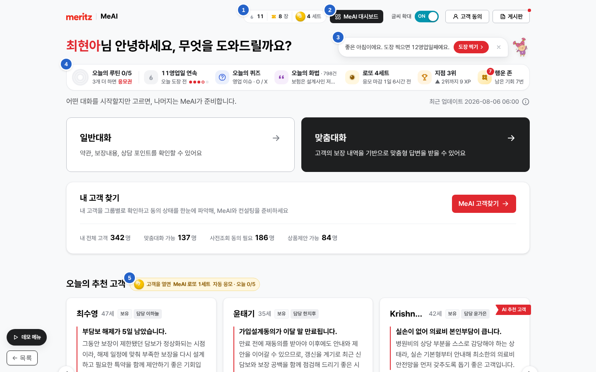

원래 홈(일반대화 · 맞춤대화 · 내 고객 찾기 · 오늘의 추천 고객)은 자리 · 크기 그대로이고, 파란 번호 ①~⑤가 새로 더한 부품이다. ⑥ 카드 배지는 추천 고객 카드 안(첫 화면 아래쪽)에 붙는다.

| 번호 | 부품 | 자리 | 크기 |
|---|---|---|---|
| ① | 내 기록 캡슐 `.nz-cap .nz-capb` | 머리 띠 오른쪽 그룹 맨 앞(글씨 확대 앞) | 높이 32 · 누르면 「내 지갑」 카드 |
| ② | MeAI 대시보드 단추 `.nz-dashb` | 캡슐 바로 오른쪽 | 높이 32 · 검정 |
| ③ | 버디 말풍선 `.nz-buddy` | 인사말 줄 오른쪽 끝(인사말 영역 `position: relative` 기준 오른쪽 위) | 최대 폭 520 · 높이 46 |
| ④ | 오늘의 MeAI 막대 `.nz-dockwrap` | 인사말 `<h1>` 바로 다음 | 위 여백 20 + 높이 64 = **84px 추가** |
| ⑤ | 추천 고객 안내 `.nz-rechint` | 「오늘의 추천 고객」 `<h2>` 안 끝 | 높이 26 |
| ⑥ | 카드 배지 `.nz-recb` | 각 추천 고객 카드의 사전조회동의 칩 줄 끝 | 높이 26 |

- 펼침 카드 · 연출 · 큰 창은 홈 안이 아니라 `<body>` 끝의 층에 뜬다. 홈 배치를 밀지 않는다.
- 측정값(목업, `tools/check_mockup.js`) : 막대 y=155, 추천 고객 제목 y=670, 첫 카드 y=720 → 1440×900 첫 화면 안. 가로 넘침 0.
- 글씨 확대 : 원본 홈의 `html.gate-fontscale-off` 를 그대로 따른다(켬 = 한 단계 크게). 넛지 글씨도 같이 바뀐다.

### 2-2. 막대 7칸

| 칸 | 보이는 것 | 올리면/누르면 | 숨쉬기(아직 안 함) |
|---|---|---|---|
| 오늘의 루틴 | 고리 3개 + `n/5` + 「n개 더 하면 응모권」 | 오늘의 루틴 카드 | – |
| 출석 · 연속 | 불꽃(꺼짐/켜짐) · `n영업일 연속` · 이번 주 점 5개 | 출석 카드 | 오늘 도장 전 |
| 오늘의 퀴즈 | 분류 · 형식 · 9시 전이면 「9시에 열려요」 | 퀴즈 카드 | 공개 뒤 안 풂 · 오답인데 해설 안 읽음 |
| 오늘의 화법 | 798건 중 한 줄이 n초마다 위로 굴러 바뀜 | 화법 카드(넓음) | 오늘 따라 쓰기 전 |
| 로또 | `n세트` · 마감까지 남은 시간 · 금 17시 뒤 「당첨번호 발표」 빨간 점 | 로또 카드 | 발표 뒤 결과 안 봄(금색) |
| 리그 | `지점 n위` · 위 사람까지 XP (순위 숨기기면 「주간 패스」) · 신인은 **첫 7일 여정** | 리그 카드(넓음) | – |
| 이번 주 리캡 | 금 17시 뒤에만 나타남 | 이야기 5장 | 안 봄 |
| 행운 존 (v5.1) | 클로버 · 「남은 기회 n번」 빨간 숫자 · 피버 중이면 불꽃 · 「피버 ×2 · 남은 시간」 | 행운 존 카드(넓음) | 남은 기회 · 복권이 있거나 피버 중(금색) |

**숨쉬기** : 아직 안 한 칸의 아이콘 둘레가 3.2초 주기로 옅게 빛난다. 모든 대상이 **같은 박자**(Web Animations `startTime = 0`)이고, 하면 바로 꺼진다. 움직임 줄이기 설정이면 옅은 테두리만. 추천 고객 카드 배지도 같은 박자(금색).

### 2-3. 펼침 카드 동작

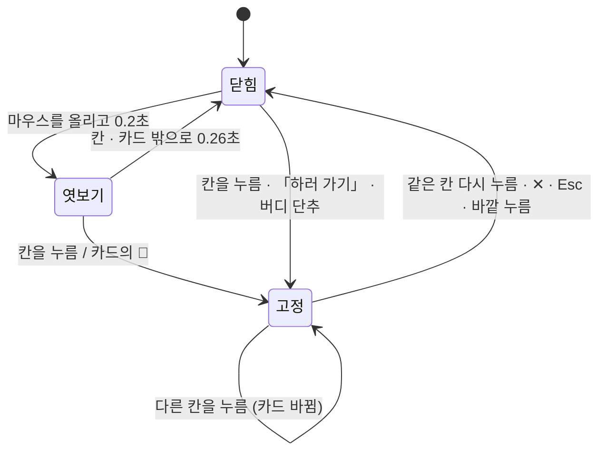

- 카드는 칸 아래 12px 에 뜨고 화면 밖으로 나가지 않게 좌우를 맞춘다. 스크롤 · 창 크기 변화에 따라 다시 맞춘다.
- 서버 응답으로 상태가 바뀌면 열린 카드를 다시 그린다. 단, **따라 쓰는 중**(`data-busy="1"`)이면 다시 그리지 않는다.
- 휴대폰(760px 이하) : 마우스 올림이 없고, 누르면 **아래에서 올라오는 시트**(위 모서리 24 · 손잡이 · 덮개)로 연다.
- 키보드 : 막대 칸은 `<button aria-expanded aria-haspopup="dialog">`. 고정으로 열면 카드의 첫 단추로 초점이 가고, Esc 로 닫으면 칸으로 돌아온다.

### 2-4. 펼침 카드 10종

| 카드 | 핵심 내용 | 행동(서버 호출) |
|---|---|---|
| 오늘의 루틴 | 큰 고리 · 고리별 n/m · 3개=일일 미션(+1) · 5개=올클리어(+2) · 퀘스트 5줄(하러 가기) · 내일 교체 미션 | 하러 가기 → 해당 기능 |
| 출석 · 연속 | 큰 불꽃 · 연속 일수 · 월~금 도장 5칸 · 개근 보너스(+3) 진행 · 다음 배지까지 · 보호권 장수 · 최근 10영업일 · 최고 기록/전사 상위 % | `POST /attend` |
| 오늘의 퀴즈 | 문제 · O/X 또는 객관식 · 결과 그림 · 세 줄 해설 · 출처 · 지점/전사 정답률 | `POST /quiz/{id}/answer` · `/explained` · MeAI에게 더 묻기(홈 `ask`) |
| 오늘의 화법 | 분류 · 상황 · 추천/우수사례 표시 · 핵심 문장 · 제출자(가린 이름 · 본부) · 전체 화법/포인트/팁 · 공감/저장/써봤어요 · **따라 쓰기**(맞은 글자 초록 · 틀린 글자 빨강 · 띄어쓰기/문장부호 무시) · 다른 화법 · 전체 798 · MeAI로 다듬기 | `POST /talks/{id}/copy` · `PUT /talks/{id}/reactions/{type}` |
| 로또 | 이번 주 세트 · 마감/추첨까지 · 내 번호(발표 뒤 맞은 공 금테) · 받는 법 · 확률(지금 n세트 · 주 10세트 · 번호 35개) · 등수표 · 지난주 결과 · 씨앗 지문 | 추천 고객 보러 가기 · 당첨번호 발표 보기 |
| 리그 · 주간 패스 | 범위(지점 리그 · 본부 안 지점 · 전사 본부) · 패스 5단계 · 순위(3위까지 골드 · 나만 실명) · 응원 · 역전 힌트 · 지점 함께 미션 · 미사용 동료 대비 | `POST /cheers` · `GET /league?scope=` |
| 첫 7일 여정 (신인) | 7단계(출석 · 퀴즈 · 추천 고객 · 맞춤대화 · 화법 · 사전조회동의 · 내 기록) | 해 보기 → 해당 기능 |
| 내 지갑 (캡슐) | 응모권 · 세트 · 보호권 · 커피 추첨 기대 확률(가정) · 오늘 받은 보상 목록 · 배지 수 | 내 기록 전체 보기 |
| 행운 존 (v5.1) | 피버 띠(남은 시간) · 게임 6칸(남은 기회 · 오늘 결과) · 영업 빙고 3×3(이번 주 · 줄 · 보상) · 확률 · 한도 공개 문구 | 각 게임 덮개 열기 · `/fun/*` |
| 넛지 설정 | 오늘의 운세로 안부 건네기(문구 복사 · 나의 오늘 운세) · 연출 · 소리 · 버디 · 순위 · 화법 전환 속도 (행운 존 · 지갑 카드 아래에서 연다) | `PATCH /settings` · `POST /events {fortune.send}` |

### 2-4-1. 카드 견본 (목업 캡처)

<div class="shots">
<figure>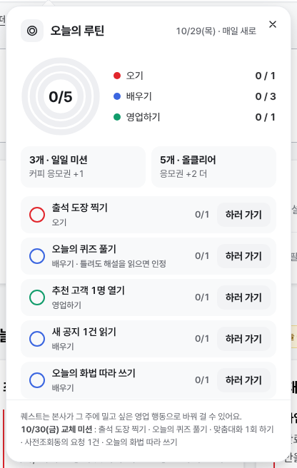<figcaption>오늘의 루틴</figcaption></figure>
<figure>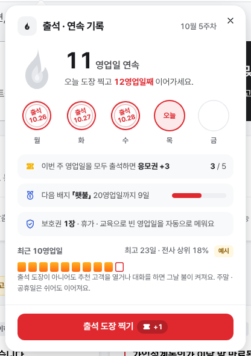<figcaption>출석 · 연속 기록</figcaption></figure>
<figure>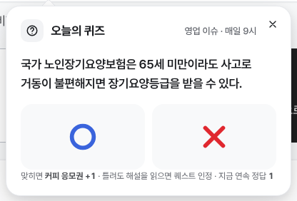<figcaption>오늘의 퀴즈</figcaption></figure>
<figure>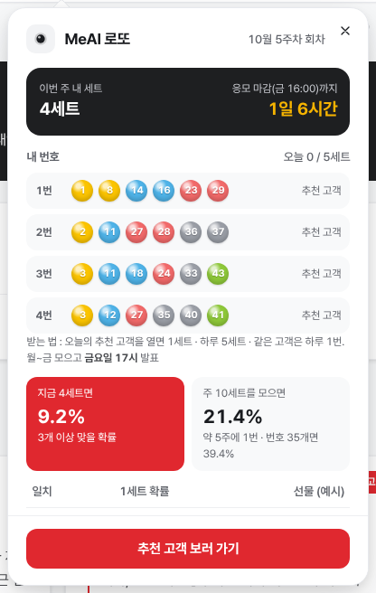<figcaption>로또(행운번호)</figcaption></figure>
<figure class="wide">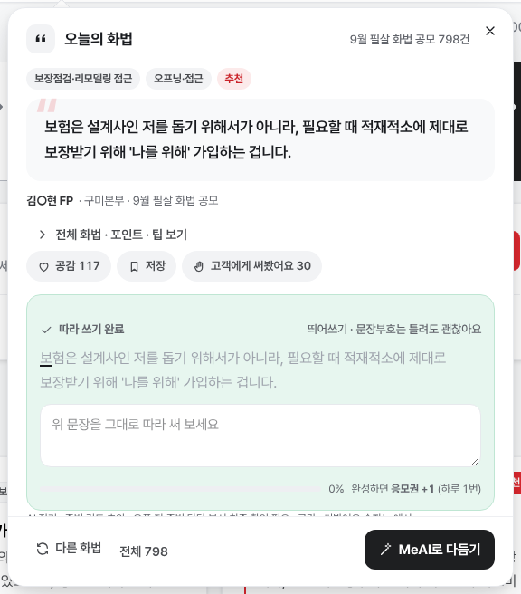<figcaption>오늘의 화법 (넓은 카드 · 따라 쓰기)</figcaption></figure>
<figure class="wide">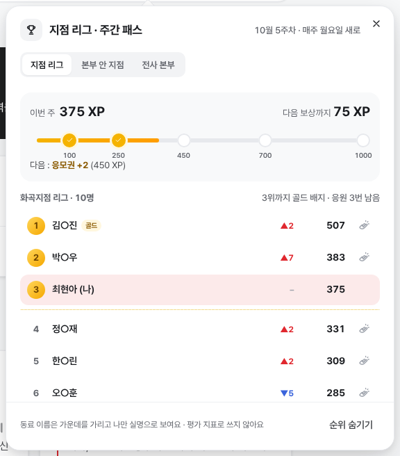<figcaption>지점 리그 · 주간 패스 (넓은 카드)</figcaption></figure>
<figure>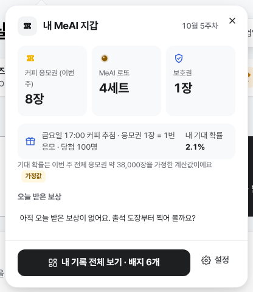<figcaption>내 지갑 (머리 띠 캡슐)</figcaption></figure>
<figure>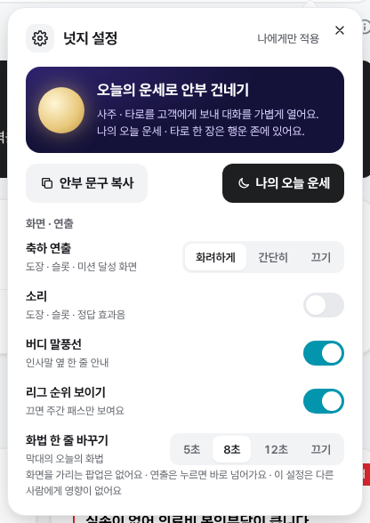<figcaption>넛지 설정</figcaption></figure>
<figure class="wide">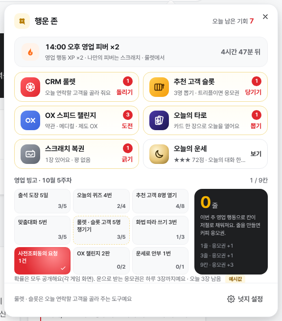<figcaption>행운 존 (v5.1) : 피버 · 게임 6칸 · 영업 빙고</figcaption></figure>
<figure>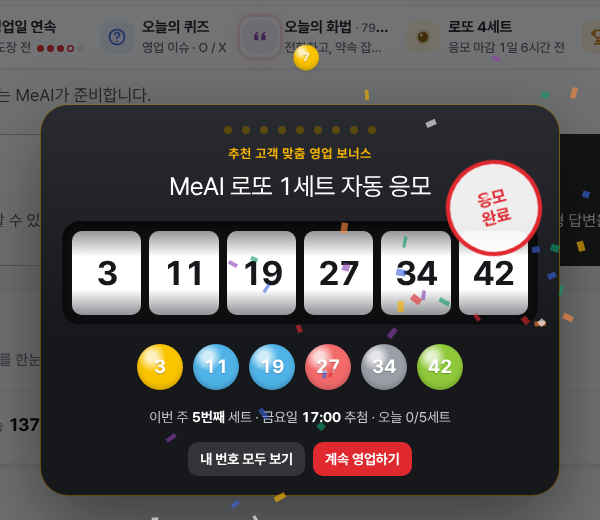<figcaption>연출 : 로또 세트 발급(슬롯)</figcaption></figure>
<figure>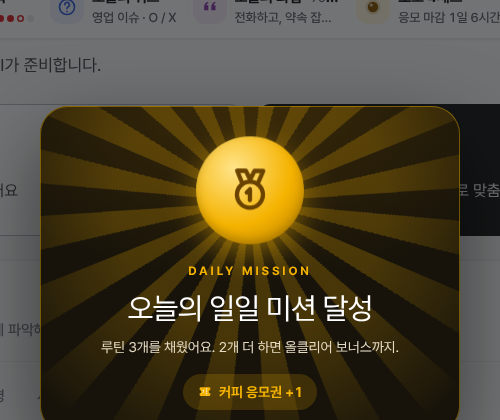<figcaption>연출 : 일일 미션 달성</figcaption></figure>
</div>

**행운 존 게임 화면 (v5.1)**

<div class="shots">
<figure>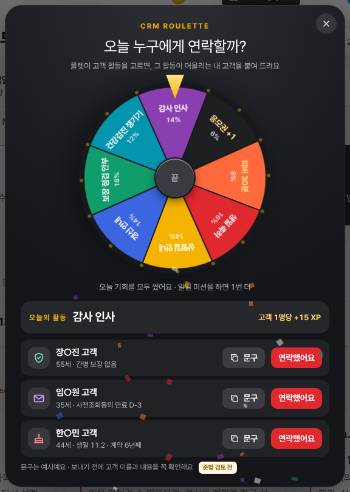<figcaption>CRM 룰렛 : 칸 확률 공개 · 고객 3명 · 안부 문구</figcaption></figure>
<figure>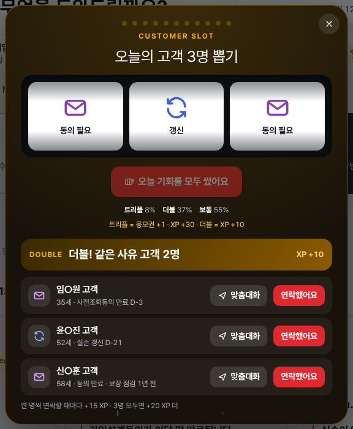<figcaption>추천 고객 슬롯 : 트리플 · 더블 · 보통</figcaption></figure>
<figure>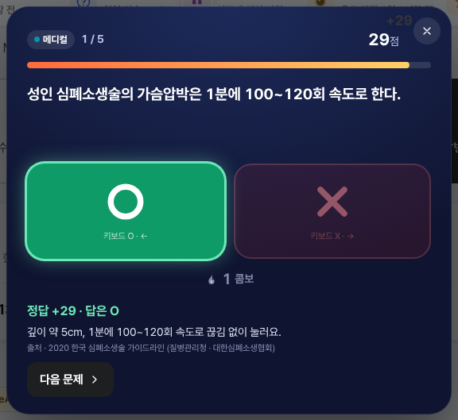<figcaption>OX 스피드 챌린지 : 10초 · 콤보 · 출처</figcaption></figure>
<figure>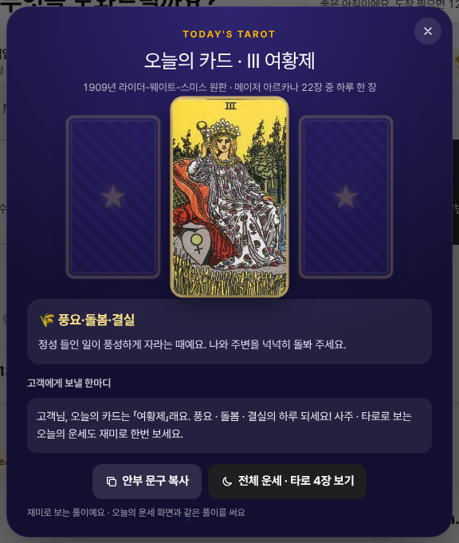<figcaption>오늘의 타로 : 1909 원판 · 고객에게 보낼 한마디</figcaption></figure>
<figure>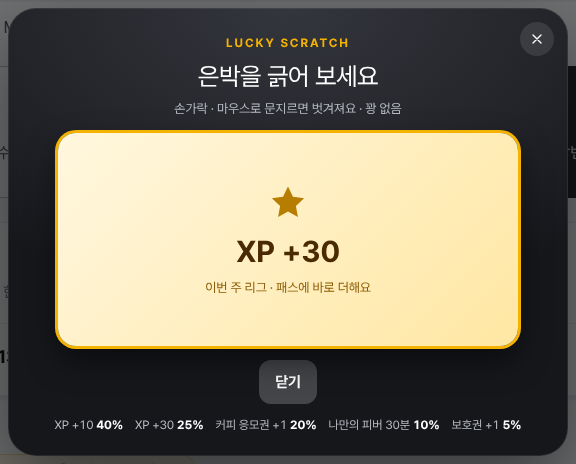<figcaption>스크래치 복권 : 꽝 없음 · 경품 확률 공개</figcaption></figure>
<figure>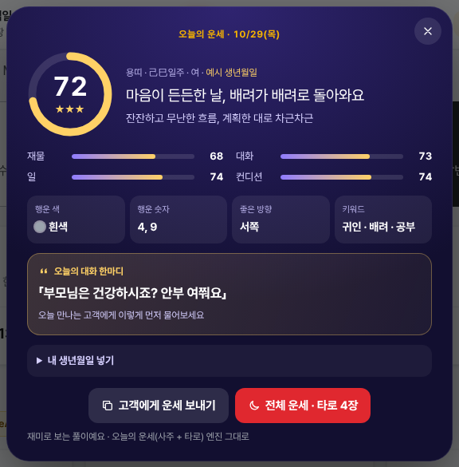<figcaption>오늘의 운세 : 사주 점수 · 오늘의 대화 한마디</figcaption></figure>
<figure class="wide">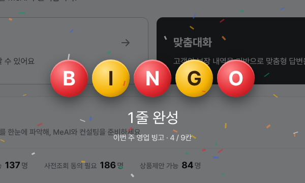<figcaption>연출 : 영업 빙고 줄 완성</figcaption></figure>
</div>

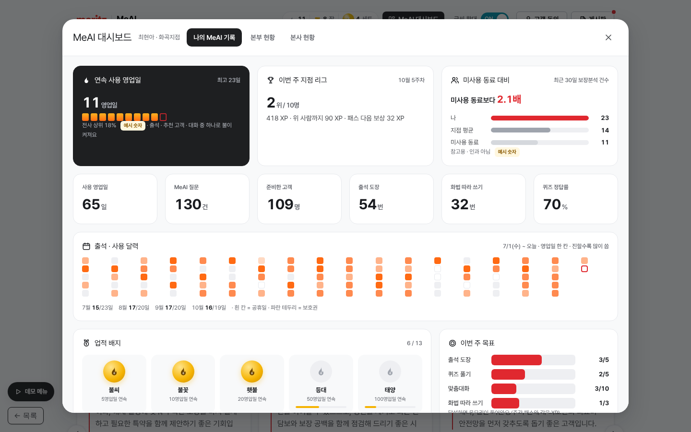

### 2-5. 연출 12종 (fx)

서버가 행동 결과와 함께 **연출 목록(fx)** 을 보낸다. 화면은 하나씩 차례로 재생하고(겹치지 않음), 응모권은 머리 띠 캡슐로 날아간다.

| fx.type | 언제 | 화려하게(full) | 간단히(simple) |
|---|---|---|---|
| `stamp` | 출석 | 도장 쾅 · 잉크 번짐 · 카드 흔들림 · 색종이 · 응모권 날아감 | 응모권만 |
| `flame` | 그날 첫 점화 | 불꽃 켜짐 · 「n영업일 연속」 알림 | 알림 |
| `quest` | 퀘스트 하나 달성 | MISSION CLEAR 카드 쾅 → 루틴 고리로 쏙 | 알림 |
| `mission` | 3개 달성 | 금빛 광선 · 메달 · 응모권 +1 | 알림 |
| `allclear` | 5개 달성 | 광선 · 별 · 양쪽 색종이 · +2 | 알림 |
| `slot` | 로또 세트 발급 | 릴 6개 회전 → 왼쪽부터 딩 · 공 · 「응모 완료」 도장 · 몇 번째 세트 · 릴 누르면 즉시 멈춤 | 번호 알림 |
| `quiz` | 퀴즈 답 | 정답이면 색종이 · 응모권 · 3연속부터 「n연속」 | 알림 |
| `talk` | 따라 쓰기 완성 | 색종이 · 응모권(하루 1번) | 알림 |
| `streak` | 5 · 10 · 20 · 30 · 50 · 100영업일 | 큰 숫자 · 불꽃 메달 · 배지 | 알림 |
| `pass` · `rankup` · `badge` · `perfect` · `shield` · `cheer` | 패스 단계 · 순위 상승 · 배지 · 개근 · 보호권 사용 · 응원 | 알림 + 해당 칸 통통 | 알림 |
| `first` | 신인의 첫 경험 7가지 | 파란 광선 · 걱정인형 · 한 줄 | 알림 |
| (발표) | 금 17시 뒤 결과 보기 | 공 6개가 하나씩 굴러 나옴 → 내 세트 맞은 공 금테 → 당첨 띠 | – |
| (리캡) | 금 17시 뒤 | 이야기 5장(5초씩 · 좌우 누르기 · Esc) | – |
| `bingo` · `fever` · `scratchNew` · `cslotClear` · `capped` (v5.1) | 빙고 줄 완성 · 나만의 피버 · 스크래치 발급 · 슬롯 클리어 · 운 응모권 한도 | BINGO 공 5개 · 피버 광선 · 알림 | 알림 |
| `roulette` · `cslot` · `challenge` · `tarot` · `scratch` · `crm` (v5.1) | 행운 존 게임 결과 | 게임 덮개가 직접 보여 줌(대기열에서는 다시 그리지 않음) | – |

- 모든 연출은 **누르면 바로 닫힘 · Esc · 자동 닫힘(2.6~3.2초)**. 화면을 가리는 공지 팝업은 없다.
- 설정 `fx = off` 이면 숫자만 바뀌고 화면 읽기 프로그램에만 알린다(`aria-live`).
- 소리는 파일 없이 Web Audio 로 합성. **기본 꺼짐**(사무실), 설정에서 켠다.

### 2-6. 큰 창 2개

| 창 | 내용 |
|---|---|
| 화법 전체 보기 | 왼쪽 카테고리 14개(건수) + 빠른 보기(추천 454 · 우수사례 30 · 따라 쓴 · 저장한 · 내가 제출한 · 검토 필요 71 · 짧은 응답 40) / 가운데 검색(내용 · 이름 · 본부 · 담보) · 상황 · 정렬 4종 · 현장 인기 TOP 5 · 40건씩 더 보기 / 오른쪽 상세 · 따라 쓰기 · MeAI로 다듬기. 탭 「배너 설정」(카테고리 · 속도 5/8/12초/끄기 · 순서 3종 · 검토 필요/짧은 응답 켜기) · 「내 화법 제출」(검수 대기) |
| MeAI 대시보드 | ① 나의 MeAI 기록(본인만) ② 본부 현황(본부장 · 지점장 · 팀장, 자기 조직만, 원문 비열람) ③ 본사 현황(본사 데이터 담당). 자세한 것은 10장 |

## 3. 넛지 기능 규칙

숫자는 모두 `config/nudge.config.json` 의 값이다. 규칙의 기준 구현은 `src/core/rules.js` 이고, 아래 표와 다르면 **rules.js 가 기준**이다(테스트 벡터로 묶여 있음).

### 3-1. 보상 · 한도

| 행동 | 보상 | 한도 | 규칙 코드 |
|---|---|---|---|
| 출석 도장 | 커피 응모권 1장 | 영업일 1번 | `attend` |
| 이번 주 영업일 개근 | 응모권 +3 | 주 1번(그 주 마지막 출석 때) | `attend.perfect` |
| 퀴즈 정답 | 응모권 1장 | 하루 1문제 | `quiz.correct` |
| 화법 따라 쓰기 완성 | 응모권 1장 | 하루 1번(연습은 무제한) | `talk.copy` |
| 퀘스트 3개 | 응모권 +1 | 하루 1번 | `quest.mission` |
| 퀘스트 5개 | 응모권 +2 | 하루 1번 | `quest.allclear` |
| 추천 고객 맞춤대화 | **로또 1세트** | 하루 5세트 · 같은 고객 하루 1번 · 오늘 추천 목록 고객만 | `lotto.issue` |
| 주간 패스 100/250/450/700/1000 XP | 응모권 +1 · 보호권 +1 · 응모권 +2 · 골드 테두리 · 응모권 +3 + MVP 테두리 | 주 1번씩 | `pass.0` ~ `pass.4` |
| 매달 첫 평가 | 보호권 +2 (최대 3장) | 월 1번 | `shield.monthly` |

- **커피 응모권**은 가볍게 들어오는 행동(출석 · 퀴즈 · 퀘스트), **로또**는 영업에 직접 닿는 행동(추천 고객 맞춤대화)에만 준다.
- 로또 발급 시점 `lotto.issueOn` : 운영 권장 `chat.custom`(맞춤대화가 실제로 시작될 때). 목업 시연은 `reco.open`(카드를 열 때).

### 3-2. XP (리그 · 주간 패스 점수)

| 행동 | XP | 하루 횟수 상한 |
|---|---:|---:|
| 출석 | 10 | 1 |
| 퀴즈 풀기 / 정답 보너스 | 10 / +5 | 1 |
| 화법 따라 쓰기 | 15 | 1 |
| 추천 고객 열기 | 20 | 10 |
| 맞춤대화 | 30 | 10 |
| 일반대화 | 5 | 5 |
| 공지 읽기 | 5 | 3 |
| 사전조회동의 요청 | 20 | 5 |
| 동료 응원 | 2 | 3 |
| 퀘스트 하나 달성 | 5 | 5 |
| 룰렛 · 슬롯 고객 챙기기 `crm.done` (v5.1) | 룰렛 칸별 15~25 · 슬롯 15 | 8 |
| 슬롯 보너스 · 클리어 (v5.1) | 더블 10 · 트리플 30 · 3명 모두 20 | – |
| OX 챌린지 한 판 (v5.1) | 점수 ÷ 10 (최대 약 20) | 3 |
| 오늘의 타로 (v5.1) | 3 | 1 |
| 스크래치 XP 경품 (v5.1) | 10 · 30 | – |

- **피버 타임(v5.1)** : `fever.kinds`(추천 고객 열기 · 맞춤대화 · 사전조회동의 · 고객 챙기기)의 XP 만 배수(예시 ×2). 응모권 · 로또 · 퀘스트에는 영향이 없다. 오후 피버(영업일 14:00~15:00)와 나만의 피버가 겹치면 큰 배수 하나만.
- 리그는 **같은 지점 · 같은 주(월 0시 ~ 일 24시)** 의 XP 순위. 같은 점수면 먼저 도달한 사람이 위. 3위까지 골드 배지. 매주 월요일 0시 새로.
- 역전 힌트 : 위 사람과의 차이를 넘는 가장 작은 행동을 고른다(`catchUpHint`). 예) 9 XP 차이 → 「출석 도장 한 번이면 역전」.

### 3-3. 연속 기록 · 보호권

- 그날 **불이 켜지는 행동** : 출석 · 추천 고객 열기 · 맞춤대화 · 일반대화 · 룰렛/슬롯 고객 챙기기(v5.1) (`streak.litBy`).
- 연속 일수 = 오늘(켜졌으면)부터 거꾸로 영업일을 세다가 불도 보호도 없는 날에서 멈춘 수. 주말 · 공휴일 · 근태상 휴가 · 교육일(`personalOff`)은 건너뛴다.
- 보호권 : 그날 첫 계산 때 지난 빈 영업일을 확인해, **빈 날 수 ≤ 보호권 장수면 모두 메우고 장수를 뺀다. 모자라면 하나도 쓰지 않는다**(어차피 끊기므로). 메운 날은 연속을 잇지만 일수는 늘리지 않는다.
- 16시 뒤 아직 불이 꺼져 있으면 `atRisk` → 버디 말풍선 「추천 고객 1명만 열어도 이어져요」.
- 배지 : 5 불씨 · 10 불꽃 · 20 횃불 · 50 등대 · 100 태양 (축하는 30 에도).

### 3-4. 오늘의 루틴 (퀘스트)

| id | 제목 | 고리 | 세는 행동 | 목표 |
|---|---|---|---|---:|
| `attend` | 출석 도장 찍기 | 오기 | attend | 1 |
| `quiz` | 오늘의 퀴즈 풀기 | 배우기 | 정답 또는 오답 + 해설 읽음 | 1 |
| `reco_open` | 추천 고객 1명 열기 | 영업하기 | reco.open | 1 |
| `notice_read` | 새 공지 1건 읽기 | 배우기 | notice.read | 1 |
| `talk_copy` | 오늘의 화법 따라 쓰기 | 배우기 | talk.copy | 1 |
| `chat_custom` (교체용) | 맞춤대화 1회 하기 | 영업하기 | chat.custom | 1 |
| `age_up_3` (교체용) | 상령일 임박 고객 3명 열기 | 영업하기 | reco.open + 태그 age_up | 3 |
| `consent_req` (교체용) | 사전조회동의 요청 1건 | 영업하기 | consent.request | 1 |
| `fortune_send` (교체용) | 고객에게 운세 링크 보내기 | 영업하기 | fortune.send | 1 |
| `crm_done` (교체용 · v5.1) | 룰렛 · 슬롯 고객 1명 챙기기 | 영업하기 | crm.done | 1 |
| `ox_run` (교체용 · v5.1) | OX 스피드 챌린지 1판 | 배우기 | challenge.finish | 1 |

- 날짜별 다섯 개는 `questSchedule` 로 정한다(없으면 `default`). 본사가 그 주에 밀고 싶은 영업 행동을 **관리 화면에서 교체**한다(15장).
- 고리 = 그 고리에 속한 퀘스트 중 달성한 비율. 막대 · 카드가 같은 값을 쓴다.

### 3-5. 오늘의 퀴즈

- 상품 담당이 등록 → **준법 검수** → 매일 9시 공개(하루 1문제). 형식 OX · 객관식(보기 2~5개).
- 정답은 답하기 전에는 화면으로 보내지 않는다(서버만 앎). 답한 뒤 응답에 정답 · 세 줄 해설 · 출처 · 「더 묻기」 질문이 붙는다.
- 틀려도 해설을 끝까지 읽고 「해설 다 읽었어요」를 누르면 퀘스트 인정(응모권은 정답만). 목적은 시험이 아니라 **전달**.
- 지점별 참여율 · 정답률은 대시보드 「전달 도달 지도」로 모인다.
- **등록 문항이 없는 날(v5.1)** : OX 문제 은행(`data/ox_bank.json`)에서 갈래(오늘의 약관 → 메디컬 → 제도 → 준법 → MeAI)를 번갈아 하루 한 문항을 낸다. 「오늘의 약관」 문항은 특약검색기 약관 원문의 한 구절(`check.quote`)을 붙이고 저장소에서 `python3 tools/check_quiz_terms.py` 로 글자 대조한다(질병코드는 분류표에 있는지 · 없는지까지).

### 3-6. 오늘의 화법

- 원천 : 9월 필살 화법 공모 798건(화법 마트 정리본 · 카테고리 14개). 정리 결과 : 그대로 301 · 표현 보완 426 · **검토 필요 71**, 짧은 응답(인사 · 단어) 40. 배너 기본 노출 698건.
- 오늘의 화법 = 추천 화법 중 카테고리를 번갈아 하루 한 건. 막대 한 줄은 배너 설정(카테고리 · 속도 · 순서)을 따른다.
- 따라 쓰기 채점(`copyScore`) : 글자 · 숫자만 남겨 앞에서부터 비교, **95% 이상 맞고 끝까지 쓰면 완성**. 붙여 넣기는 막는다. 서버도 같은 함수로 다시 채점한다.
- 제출자 이름은 **가운데를 가려** 보인다(김○주). 실명 표시는 준법 · 본인 동의 확인 뒤 설정으로 연다.
- 「내 화법 제출」은 검수 대기(`pending`)로 들어가 같은 검수를 거쳐 화법 마트에 반영된다.

### 3-7. 로또 (명칭 후보 : MeAI 행운번호)

| 항목 | 규칙 |
|---|---|
| 회차 | ISO 주(월요일 시작). 화면 이름은 그 주 목요일 기준 「n월 n주차」 |
| 모으기 | 월 0시 ~ **금 16:00 마감**. 마감 뒤 받은 세트는 다음 주 회차 |
| 발표 | **금 17:00**. 번호 1~45 중 6개(`pool` · `pick` 설정. 35개로 줄이면 당첨률 상승) |
| 등수(예시) | 3개 일치 커피 쿠폰 · 4개 치킨 세트 · 5개 이상 모바일 상품권. 등수별 **당첨 인원 상한(cap)** 으로 예산 고정, 넘으면 그 등수 안에서 추첨 |
| 확률(계산값) | 1세트 3개 이상 2.38% · 주 10세트면 21.4% · 번호 35개면 39.4% |
| 예산 가늠(가정) | 주간 응모 1만 세트 가정 시 3개 일치 약 224명 · 4개 약 14명 · 5개 이상 1명 미만. 주간 예산 = 등수별 인원 × 경품 단가(미정) |
| 공정성 | 10장 |

### 3-8. 리그 부가 기능

- **주간 패스** : 이번 주 XP 가 100 · 250 · 450 · 700 · 1000 을 넘을 때마다 보상. 700 이상 골드, 1000 MVP 테두리가 그 주 리그 이름 옆에 붙는다.
- **지점 함께 미션** : 지점 전체가 이번 주 채우는 목표(예 : 맞춤대화 300회). 목표는 본사가 지점별로 정하거나 지난주 × 1.1.
- **동료 응원** : 같은 지점 동료에게 하루 3번, 한 사람에 하루 1번. 받은 사람에게 「○○님이 응원했어요」.
- **미사용 동료 대비** : 최근 30일 보장분석 건수를 나 · 지점 평균 · 미사용 동료와 비교, 「n배」. **참고용 · 인과 아님** 표시.
- **순위 숨기기** : 설정에서 끄면 순위 대신 주간 패스만 보인다.

### 3-9. 버디 말풍선 (시간대 넛지)

설정 `buddy` 목록을 위에서부터 보고 **처음 맞는 하나**만 보인다. 닫으면 그날은 다시 안 뜬다.

| id | 시간 | 조건 | 문구(예) |
|---|---|---|---|
| draw_res | 금 17:00~ | 결과 안 봄 | 이번 주 당첨번호가 나왔어요 |
| risk | 16:00~ | 오늘 불 꺼짐 | 추천 고객 1명만 열어도 n영업일째로 이어져요 |
| draw_d0 | 금 12:00~15:59 | – | 오늘 17시 추첨, 마감 16시 |
| monday | 월 07:00~11:30 | 출석 전 | 새 회차가 시작됐어요 |
| morning | 07:00~11:30 | 출석 전 | 도장 찍으면 n영업일째예요 |
| quiz | 09:00~18:00 | 출석함 · 퀴즈 안 함 | 오늘의 퀴즈가 열렸어요 |
| mission | 09:00~18:00 | 퀘스트 하나 남음 | 올클리어까지 하나 남았어요 |
| fever (v5.1) | 영업일 14:00~14:59 | – | 오후 피버 타임이에요. 지금 XP 2배 |
| roulette (v5.1) | 10:00~16:00 | 출석함 · 룰렛 남음 | 오늘의 고객 룰렛을 아직 안 돌렸어요 |
| lunch | 11:30~14:00 | 화법 안 씀 | 점심 전에 화법 한 줄 |

걱정인형 그림은 `ui/mascots` 의 2D 판(메리츠 걱정인형 가이드 · 홍보파트 규정 준수 : 비율 유지 · 색 변경 금지 · 같은 테마끼리).

### 3-10. 주간 리캡 · 첫 7일 여정

- **주간 리캡** : 금 17시 뒤(주말 포함) 막대에 「이번 주 리캡」 칸이 생긴다. 이야기 5장 = 불 켠 날 · 준비한 고객과 맞춤대화 · 퀴즈와 화법 · 모은 보상 · 다음 주 제안(규칙 기반 문장 2개).
- **첫 7일 여정** : 입사 3개월 이하(`onboarding.maxJoinMonth`)이면 리그 칸이 여정으로 바뀐다. 7가지 첫 경험마다 한 번씩 축하(`first`). 기존 FP 에게는 첫 경험 축하를 띄우지 않는다.

### 3-11. 행운 존 (v5.1)

모든 결과는 **서버(규칙 엔진)** 가 정하고 화면은 응답을 받은 뒤 그 자리에 멈추는 연출만 한다. 확률은 설정 가중치 그대로이며 각 게임 화면에 **숫자로 공개**한다. 숫자 · 경품 · 문구는 모두 확정 전 예시(가정값)다.

| 게임 | 기회 | 결과 정하기 | 보상 | 규칙 코드 |
|---|---|---|---|---|
| CRM 룰렛 | 하루 1번 + 일일 미션 때 1번 더 | 8칸 가중치(생일 16 · 상령일 14 · 갱신 14 · 보장 점검 16 · 건강검진 12 · 감사 14 · 응모권 6 · 피버 8, 합 100). 활동 칸이면 그 태그가 붙은 내 고객 중 오늘 안 챙긴 3명(없으면 연락이 뜸한 고객 · `fallback`) | 보너스 칸 : 응모권 +1 · 나만의 피버 30분 / 활동 칸 : 고객마다 「연락했어요」 → 칸별 XP | `roulette.bonus` · `crm.done` |
| 추천 고객 슬롯 | 하루 1번 + 올클리어 때 1번 더 | 단계 먼저 : 트리플 8 · 더블 37 · 보통 55 → 그 단계에 맞게 고객 3명. 고객이 모자라면 낮은 단계로 | 트리플 응모권 +1 · XP 30 / 더블 XP 10 / 고객마다 15 / 3명 모두 20 | `cslot.jackpot` · `crm.done` · `cslot.clear` |
| OX 스피드 챌린지 | 하루 3판 | 문제 은행에서 갈래를 번갈아 5문제(최근에 푼 것은 뒤로). 답은 서버만 앎 | 점수 = 정답 20 + 남은 초 × 1 + (연속 정답 − 1) × 5 → XP = 점수 ÷ 10 / 5문제 만점 응모권 +1(하루 1번) · 배지 「OX 백점」 | `challenge.perfect` |
| 오늘의 타로 | 하루 1번 | `tarotOfDay(사용자, 날짜)` = SHA-256 씨앗으로 메이저 22장 중 정해진 3장 → 고른 자리의 카드(다시 뽑아도 같음) | XP 3 | `tarot.draw` |
| 스크래치 복권 | 일일 미션 · 올클리어 때 1장씩 · 받은 날부터 7일 | **발급 때** 경품을 정해 둔다 : XP 10 (40) · XP 30 (25) · 응모권 +1 (20) · 나만의 피버 30분 (10) · 보호권 +1 (5) | 꽝 없음 | `scratch` |
| 영업 빙고 | 주간(ISO 주) | 칸 = 이번 주 행동 누적 : 출석 5일 · 퀴즈 4번 · 추천 고객 8명 · 맞춤대화 5번 · 룰렛/슬롯 고객 5명 · 화법 3번 · 사전조회동의 1건 · OX 챌린지 2판 · 운세 안부 1번 | 1줄 응모권 +1 · 3줄 +1 · 9칸 모두 +3 · 배지 「빙고 마스터」 | `bingo.0` ~ `bingo.2` |
| 오늘의 운세 | 언제나 | 화면에서 계산(사주 엔진 원본 `NZ_SAJU.fortune`) · 서버로는 `fortune.open` 사실만 | – | – |

- **운 응모권 하루 한도** `fun.ticketCapDaily = 3` : 룰렛 보너스 · 슬롯 트리플 · 스크래치 · OX 만점처럼 운이나 놀이로 받는 응모권은 하루 3장까지. 넘치면 장당 XP 10 으로 바꿔 주고 알린다(`capped`). 영업 행동에서 오는 빙고 응모권은 한도와 별개.
- **고객 챙기기(`crm.done`)는 화면 신고**라 XP 만 주고 응모권은 주지 않는다. 운영에서는 문자 · 알림톡 발송 이벤트(서버 간)로 확정할 수 있다. 같은 고객은 하루 1번, 룰렛 · 슬롯 결과에 있는 고객만.
- **안부 문구**는 활동별 예시(설정 `fun.roulette.segments[].tpl`)이며 `{name}` 자리에 고객 이름이 들어간다. 「MeAI로 다듬기」는 일반대화 입력칸에 넣기만 한다. 준법 검토 전 문구다.
- **오늘의 운세** : 화면에 오늘의 운세 엔진(`src/vendor/unse-engine.js` = `fortune/src/engine.js` 원본, 고치지 않음)을 함께 싣는다. 내 생년월일은 이 기기(localStorage)에만 두고 서버로 보내지 않는다(없으면 예시 생년월일로 보여 주고 「예시」 표시). 전체 운세 · 타로 4장은 사내 웹서버 `unse/`(목업은 옆 파일)를 덮개 안 iframe 으로 연다.
- **타로 카드 그림**은 1909년 라이더-웨이트-스미스 원판(공개 저작물)이며 「죽음」 등도 원판 그대로 쓴다(소유자 2026-10-29). 오늘의 한 장은 정방향 풀이만 보여 준다.

## 4. 시스템 구조

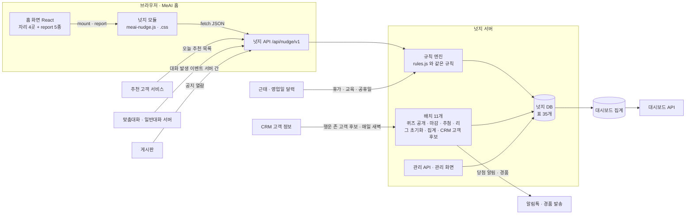

- **화면은 계산하지 않는다.** 행동을 서버에 보내고, 서버가 규칙 엔진으로 보상을 정해 「새 홈 요약(home) + 연출 목록(fx)」을 돌려준다.
- **영업 행동의 진실은 서버 간 이벤트로.** 맞춤대화 · 일반대화 · 공지 열람은 화면의 `report` 만 믿지 않고, 대화 서버 · 게시판이 넛지 서버에 서버 간 이벤트로도 알린다(어뷰징 방지). 화면 `report` 는 즉시 연출용, 서버 간 이벤트는 확정용이며 같은 `idem` 으로 한 번만 센다.
- 사용자 · 조직은 서버가 로그인 세션으로 안다. 화면은 사용자 id 를 보내지 않는다.

## 5. 화면 ↔ 서버 약속 (API 요약)

기본 경로 `/api/nudge/v1`. 전체 명세 `docs/openapi.yaml`. 화면 쪽 구현 `src/api/client.js`, 같은 모양의 모의 서버 `src/api/mock.js`.

| 메서드 · 경로 | 하는 일 | 응답 |
|---|---|---|
| `GET /home` | 홈 요약(막대 · 캡슐 · 카드 · 버디 · 배지에 필요한 전부) | Home |
| `POST /attend` | 출석 도장 | ActionResult |
| `POST /events` | 홈 쪽 영업 행동 : `reco.open` · `chat.custom` · `chat.general` · `notice.read` · `consent.request` · `fortune.send` · `dash.open` | ActionResult |
| `POST /quiz/{id}/answer` · `/explained` | 퀴즈 답 · 해설 확인 | ActionResult |
| `GET /talks` · `GET /talks/{id}` | 화법 목록(40건씩) · 한 건 | TalkPage · Talk |
| `POST /talks/{id}/copy` | 따라 쓰기 완성(서버가 다시 채점) | ActionResult |
| `PUT /talks/{id}/reactions/{like\|save\|used}` | 공감 · 저장 · 써봤어요 | Talk + Home |
| `POST /talks` | 내 화법 제출 → 검수 대기 | 접수 결과 |
| `GET /league?scope=branch\|hq\|company` | 리그 · 조직 순위 | League |
| `POST /cheers` | 동료 응원 | ActionResult |
| `POST /lotto/{round}/seen` · `POST /recap/{week}/seen` | 발표 · 리캡 봤음 | Home |
| `GET /recap?week=` | 주간 리캡 | Recap |
| `GET /me/record` | 나의 MeAI 기록 | Record |
| `GET /dash/org?scope=` · `GET /dash/hq` | 본부 · 본사 현황 (권한) | OrgDash · HqDash |
| `PATCH /settings` · `POST /buddy/{id}/dismiss` | 넛지 설정 · 말풍선 닫기 | Home |
| `POST /logs` | 화면 사용 기록 묶음(sendBeacon) | ok |
| `POST /fun/roulette/spin` · `/fun/cslot/pull` (v5.1) | CRM 룰렛 · 추천 고객 슬롯 | ActionResult (+data) |
| `POST /fun/crm/done` (v5.1) | 룰렛 · 슬롯 고객 연락했어요 `{ref: 'r:spinId' \| 's:pullId', customerId}` | ActionResult |
| `POST /fun/scratch/{id}/reveal` (v5.1) | 스크래치 긁기 | ActionResult (+data) |
| `POST /fun/challenge/start` · `/fun/challenge/{runId}/answer` (v5.1) | OX 챌린지 시작(문제만) · 한 문제 답(정답 · 해설 · 출처 · 점수, 마지막은 summary) | ActionResult (+data) |
| `POST /fun/tarot/draw` (v5.1) | 오늘의 타로 한 장 `{pick: 0~2}` | ActionResult (+data) |

**쓰기 응답 ActionResult** = `{ ok, reason, grants[], fx[], data, home }` (`data` 는 행운 존 게임 결과, 다른 행동은 null)

- `ok=false` 는 오류가 아니라 「보상 없음」 : `already`(이미 함) · `not_bizday` · `limit` · `lotto_daily_max` · `not_done` · `no_quiz` · `same_customer` · (v5.1) `no_plays` · `no_customers` · `no_target` · `no_scratch` · `expired` · `no_run` · `order`. 화면은 짧은 안내만 띄운다. HTTP 오류는 4xx/5xx.
- `grants[]` : `{ ts, day, type: ticket|lotto|shield|badge, amount, rule, label, ref }`. 원장(nz_ledger)에 쓴 그대로.
- **멱등** : 모든 쓰기에 `idem`(화면이 만든 UUID). 서버는 `(user, idem)` 이 이미 있으면 처음 결과를 그대로 돌려준다(두 번 누름 · 재전송 · 서버 간 이벤트 중복 방지).
- 시각은 epoch ms, 날짜는 한국 시간 `YYYY-MM-DD`. 화면 표시용 남은 시간은 `serverTime` 기준.

### 5-1. 홈 요약(Home) 주요 필드

| 필드 | 내용 |
|---|---|
| `serverTime · today · hm · dow · bizDay · holiday` | 서버 시각 · 오늘 · 영업일 여부 |
| `user` | 이름 · 지점 · 본부 · 역할 · 입사 차월 · 신인 여부 (동료 이름은 서버에서 가려서 보낸다) |
| `labels` | `lotto`(MeAI 로또 / MeAI 행운번호) · `ticket` · `shield` |
| `settings` | `fx · sound · hideRank · buddy · tickerSec · tickerCats · tickerOrder · showBlocked · showShort` |
| `streak` | `current · best · todayLit · nextStreak · nextMilestone · nextBadge · atRisk · shields · last10[] · topPercent` |
| `week` | `id · label · days[{day, state: stamp\|lit\|shield\|miss\|today\|future\|holiday}] · attended · bizDays · perfect · xp` |
| `wallet` | `tickets · todayTickets · sets · shields · badges · today[](오늘 원장) · coffee{winners, prize, poolAssumed}` |
| `quests` | `items[{id, title, ring, go, progress, target, done}] · done · total · rings{come, learn, sell} · need · mission · allclear · next{date, titles, changed}` |
| `quiz` | `id · type · category · question · options · open · openAt · answered · combo` (+ 답한 뒤 `choice · correct · explained · answer · explain[] · source · ask · stats`) |
| `talk` | `today(Talk) · ticker[](12건) · copiedToday · total · banner` |
| `lotto` | `name · round · label · phase(collect\|closed\|drawn) · cutoffAt · drawAt · sets[] · nextRoundSets · todayIssued · dailyMax · issueOn · commit · seed(발표 뒤) · draw · drawSeen · last{} · odds{} · tiers[]` |
| `league` | `rank · total · gap · hint · goldCut · list[] · xp · pass[] · nextPass · frame · cheersLeft · cheersReceived[]` |
| `team` · `compare` | 지점 함께 미션 · 미사용 동료 대비 |
| `reco` | `issued{customerId: {opened, lotto}} · todayIssued · dailyMax · issueOn` (추천 고객 카드 배지) |
| `buddy` | `{id, mascot, text, cta{label, go}}` 또는 null |
| `notices.unread · onboarding · recap{available, week, seen} · myCustomers` | 기타 |
| `fun` (v5.1) | `plays{roulette, cslot, challenge, tarot: {total, used, left}} · fever{on, mult, until, label, kind, next} · cap · capLeft · roulette{segments[{label, color, pct}], spins[]} · cslot{symbols, odds, pulls[]} · scratch{cards[], today[], odds} · challenge{best, runsToday, perfectToday, bank, cats, max} · tarot{today} · bingo{cells[9], lines[], count, filled, rewards[]} · fortune{example}` (고객 이름은 가려서) |

## 6. 규칙 엔진

`src/core/rules.js` 하나에 모든 판정이 있다(화면 DOM 을 모르는 순수 함수). 서버를 자바 · 파이썬 등으로 만들면 이 파일을 옮기고 **`tests/vectors.json` 과 같은 결과**가 나오는지 확인한다(`node tests/rules.test.js` 와 같은 입력).

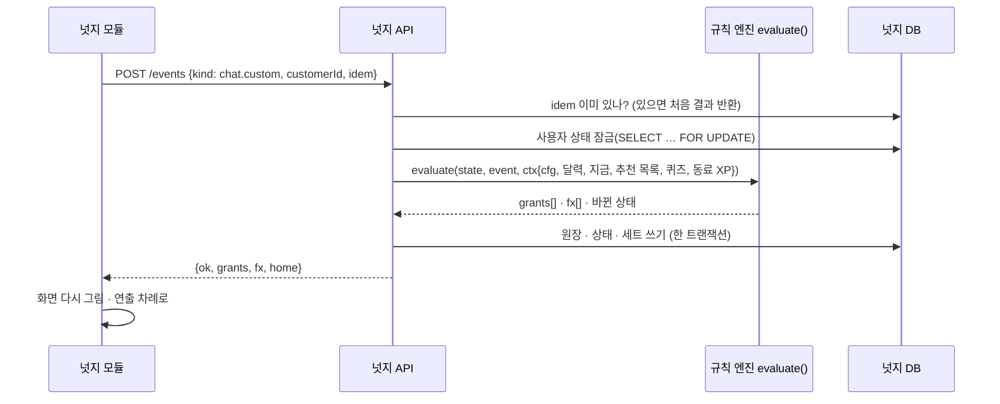

`evaluate` 의 판정 순서 (바꾸지 않는다)

1. **그날 준비** `prepareDay` : 월 보호권 채우기 → 지난 빈 영업일 보호권으로 메우기 (그날 한 번)
2. **행동별 처리** : 출석(영업일 · 하루 1번 · 개근) / 퀴즈(정답 확인 · 연속 정답) / 해설 / 따라 쓰기(재채점) / 응원(하루 3 · 1인 1) / 홈 행동(같은 고객 하루 1번 · 태그 집계) / **로또 발급**(설정한 행동 · 오늘 추천 고객 · 하루 5 · 고객당 1) / (v5.1) 룰렛 · 슬롯 · 고객 챙기기 · 스크래치 · OX 챌린지 · 타로 (XP 는 피버 배수 · 운 응모권은 하루 한도)
3. **연속 기록** : 불 켜는 행동이면 점화 → 이정표(배지)
4. **퀘스트** : 새로 달성한 것마다 `quest` fx + XP → 3개 미션 · 5개 올클리어
4-2. **스크래치 발급**(v5.1) : 일일 미션 · 올클리어 때 경품을 정해 한 장 → **영업 빙고** : 새로 생긴 줄 · 줄 수 보상(주 1번씩)
5. **주간 패스** : 넘은 단계 보상
6. **첫 경험**(신인만)
7. **리그 순위** : 행동 전보다 올랐으면 `rankup`

- 동시성 : 사용자 한 명의 행동은 **한 번에 하나**(사용자 상태 행 잠금 또는 사용자별 큐). 다른 사용자끼리는 동시에.
- 한도를 넘으면 예외를 던지지 않고 「보상 없음」으로 끝낸다. 오류가 틀린 보상이 아니라 **빈 보상**으로 나타나게 한다.
- 로또 번호(세트 발급)는 서버의 암호학적 난수(CSPRNG). 테스트는 `rng(seed)` 를 넣어 같은 결과를 낸다.
- 시간대는 한국 시간(UTC+9, 서머타임 없음) 고정.

## 7. 데이터 모델

전체 정의 `docs/schema.sql` (PostgreSQL 기준, 오라클 바꿀 곳은 주석). 표 이름은 `nz_` 로 시작한다.

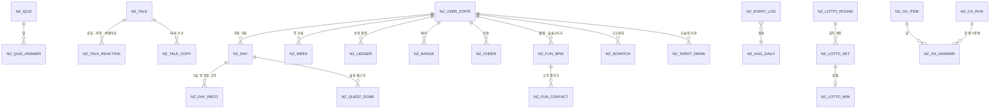

| 표 | 한 줄 |
|---|---|
| `nz_user_state` | 사용자별 보호권 · 최고 연속 · 연속 정답 · 설정 · 그날 준비 여부 |
| `nz_day` · `nz_day_reco` · `nz_quest_done` | 하루 기록(불 · 출석 · 보호 · XP · 행동별 횟수) · 그날 연 추천 고객(세트 발급 여부) · 달성 퀘스트 |
| `nz_week` | 주 XP · 응모권 · 개근 · 패스 단계 · 테두리 · 지난 순위 |
| `nz_ledger` | **모든 보상의 원장**(응모권 · 세트 · 보호권 · 배지). 지갑 · 대시보드 · 정산이 이 표만 본다. `(user_id, idem, rule)` 유일 |
| `nz_badge` · `nz_counter` · `nz_first` · `nz_seen` · `nz_buddy_dismiss` · `nz_cheer` | 배지 · 누적 횟수 · 첫 경험 · 본 것 · 닫은 말풍선 · 응원 |
| `nz_lotto_round` · `nz_lotto_set` · `nz_lotto_win` · `nz_coffee_draw` | 회차(씨앗 지문 · 씨앗 · 번호) · 세트 · 당첨 · 커피 추첨 |
| `nz_quiz` · `nz_quiz_answer` · `nz_quest_schedule` | 퀴즈(검수 상태) · 답 · 날짜별 퀘스트 |
| `nz_talk` · `nz_talk_reaction` · `nz_talk_copy` | 화법 마트 · 반응 · 따라 쓰기 |
| `nz_config` | 운영 설정 버전 이력(누가 언제 무엇을) |
| `nz_event_log` · `nz_agg_daily` | 화면 사용 기록(일 단위 파티션) · 대시보드 집계 |
| `nz_crm_customer` (v5.1) | 행운 존이 고르는 내 고객 후보(CRM 연동 · 사유 sym · 태그 · 한 줄 메모). 매일 새벽 CRM 에서 받는다 |
| `nz_fun_spin` · `nz_fun_contact` (v5.1) | 룰렛 · 슬롯 결과(칸 · 단계 · 릴 · 고른 고객) · 고객 챙기기(하루 같은 고객 1번) |
| `nz_scratch` (v5.1) | 스크래치 복권(발급 때 정한 경품 · 긁은 때 · 유효 7일) |
| `nz_ox_item` · `nz_ox_run` · `nz_ox_answer` (v5.1) | OX 문제 은행(갈래 · 출처 · 약관 대조 구절 · 검수) · 챌린지 한 판(점수 · 최고 기록) · 한 문제 답(걸린 시간 · 점수) |
| `nz_tarot_draw` · `nz_fun_day` (v5.1) | 오늘의 타로(하루 1장) · 하루 행운 존 기록(운 응모권 수 · 피버 끝 · 만점 여부) |

## 8. 배치 작업

| 이름 | 언제 | 하는 일 |
|---|---|---|
| `quiz_publish` | 매일 09:00 | 승인된 오늘 퀴즈 공개. 없으면 담당자 알림(퀴즈 칸은 「준비 중」) |
| `day_prepare` | 매일 00:10 (영업일) | 전 영업일 빈 날 보호권 처리 · 연속 끊김 확정 (화면 첫 요청 때도 같은 일을 하므로 늦어도 됨) |
| `lotto_open` | 월 00:00 | 새 회차 · 씨앗 생성(CSPRNG 32바이트) · **씨앗 지문(SHA-256) 공개** |
| `lotto_cutoff` | 금 16:00 | 응모 마감(이후 발급분 다음 회차) |
| `lotto_draw` | 금 17:00 | `drawNumbers(seed, round)` → 당첨 판정 → 등수 상한 넘으면 그 안에서 추첨 → 씨앗 공개 → 당첨 알림 · 경품 발송 요청 |
| `coffee_draw` | 금 17:00 | 응모권 1장 = 1번 응모로 당첨 n명 추첨(같은 방식의 씨앗 공개) |
| `league_reset` | 월 00:00 | 지난주 순위 저장(`prev_rank`) · 새 주 시작 |
| `shield_monthly` | 매월 1일 00:00 | 보호권 채우기(최대 3장) · 화면 첫 요청 때도 처리 |
| `agg_daily` | 매일 01:00 (+ 10분마다 당일분) | 대시보드 집계 |
| `crm_sync` (v5.1) | 매일 05:00 | CRM 에서 행운 존 고객 후보(생일 주간 · 상령일 D-30 · 갱신 D-30 · 보장 공백 · 동의 만료)를 받아 `nz_crm_customer` 갱신 |
| `ox_bank_check` (v5.1) | 약관 개정 · 문항 등록 때 | 「오늘의 약관」 문항의 대조 구절이 특약 마스터 원문에 그대로 있는지 확인(`check_quiz_terms.py` 와 같은 일). 안 맞으면 그 문항을 내린다 |

## 9. 추첨 공정성 (커밋 → 공개)

1. 회차를 열 때 서버가 비밀 씨앗(무작위 32바이트, 16진수 64자)을 만들고 **지문 `SHA-256(seed)`** 만 화면에 공개한다(로또 카드 하단).
2. 금 17시 번호는 `drawNumbers(seed, round, pool, pick)` 로만 뽑는다 : `SHA-256(seed + ":" + round + ":" + n)` 바이트로 32비트 수를 만들어 **치우침 없이(rejection sampling)** 피셔-예이츠로 섞는다.
3. 발표 때 씨앗을 공개한다. 누구나 `SHA-256(seed)` 가 미리 공개한 지문과 같은지, `drawNumbers` 가 같은 번호를 내는지 다시 계산할 수 있다(`tests/vectors.json` 의 `draw` 항목).
4. 등수 인원 상한을 넘어 추첨할 때도 같은 씨앗(`seed + ":winners:" + 등수`)을 쓴다.

## 10. 사용 기록 · 대시보드

### 10-1. 사용 기록

- 서버 이벤트(원장 · 행동)가 **사실**이고, 화면 사용 기록(`POST /logs`)은 **어디를 얼마나 눌렀나**를 본다. 정의는 `docs/EVENTS.md`.
- 화면 기록 모양 : `{ ts, el, action, meta, v }` 20건씩 묶어 보내고, 화면을 떠날 때 `sendBeacon`. 질문 원문 · 고객 이름 · 입력 내용은 **보내지 않는다**.
- 보관 : 원장 · 보상 5년(경품 · 세무), 행동 기록 1년, 화면 기록 13개월(전년 비교). 사내 기준 확인 필요.

### 10-2. 대시보드 3종

| 화면 | 보는 사람 | 내용 | 지키는 것 |
|---|---|---|---|
| 나의 MeAI 기록 | 모든 FP (본인만) | 연속 · 리그 · 미사용 동료 대비 · 숫자 6개 · 7월부터 출석/사용 달력 · 배지 10종 · 이번 주 목표 4개 · 고객 활용 흐름(노출 → 열람 → 맞춤대화 → 제안 → 가입설계) · 자주 쓰는 질문(다시 묻기) | 본인만. 리더에게는 집계만 |
| 본부 현황 | 본부장 · 지점장 · 팀장 (자기 조직) | 범위 전환 · 사용률 · 사용 FP · 누적 질문 · 인당 · 미사용 · 지점별 표(출석률 · 퀴즈 참여/정답률 포함) · **전달 도달 지도**(지점 × 최근 퀴즈 참여율) · 매출 규모 구간별 · 인기 질문 TOP 5 · 팀원 현황(상태 필터 · CSV) | 질문 원문 · 고객 정보 비열람 · 매출은 구간만 · 5건 이상만 · 평가 지표로 쓰지 않음 |
| 본사 현황 | 본사 데이터 담당 | 숫자 6개 · **출발점(실제 분석값)** · 일별 추이(넛지 오픈 표시) · 본부 비교(정렬) · 홈 요소 13종 사용량 · 요일 × 시간대 · 지역별 · 실시간 이벤트 | 대화 원문은 본사 데이터 담당만 · 개인정보 가림 |

- 권한 : 사내 SSO 의 역할(`FP` · `TEAM_LEAD` · `BRANCH_MGR` · `HQ_MGR` · `HQ_DATA`)로 탭과 API 범위를 정한다. 목업은 세 탭을 모두 열어 두었다.
- 성과 지표 : TA 침투율(8월 59.0%) · TA 헤비유저(8월 1,189명)를 먼저 보고, 출석률 · 추천 고객 열람 → 맞춤대화 전환율 · 퀴즈 참여/정답률(지점별) · 화법 따라 쓰기/저장 수를 새로 잰다. **목표 수치는 파일럿 2주 데이터로 정하고, 파일럿 · 비파일럿 지점을 비교해 효과를 분리한다.**

## 11. 보안 · 개인정보 · 준법

| 항목 | 우려 | 대응 (구현 위치) |
|---|---|---|
| 명칭 · 사행성 | 「로또」 이름 · 슬롯 연출 | 준법 검토. 명칭은 설정 하나로 전환(`labels.useAltLottoName` → 「MeAI 행운번호」). 현금성 경품 제외 |
| 경품 처리 | 제세공과금 · 시책 처리 | 재무 · 준법 확인 뒤 단가 · 인원 확정. 그전까지 화면의 경품은 「예시」 표시 |
| 어뷰징 | 카드만 반복 클릭 · 재전송 | 하루 5세트 · 같은 고객 하루 1번 · **실제 맞춤대화 발생 시 발급(서버 간 이벤트로 확정)** · 오늘 추천 목록 고객만 · 멱등 키 · XP 하루 상한 · 붙여 넣기 막기 + 서버 재채점 |
| 개인정보 · 열람 | 당첨자 · 동료 이름 · 대화 원문 | 서버에서 이름 가림(나만 실명) · 나의 기록은 본인만 · 원문은 본사 데이터 담당만 · 화면 기록에 입력 내용 안 보냄 |
| 순위 부담 | 리그 · 비교 압박 | 동료 이름 가림 · 순위 숨기기 설정 · 「평가 지표로 쓰지 않아요」 화면 고정 문구 · 비교는 「참고용 · 인과 아님」 |
| 피로도 | 연출이 업무 방해 | 화면 가리는 팝업 없음 · 연출 건너뛰기 · 소리 기본 꺼짐 · 연출 간단히/끄기 · 기존 동선 유지 |
| 화법 준법 | 단정 · 과장 · 확정 금액 · 타사 폄하 · 절판 압박 | 검토 필요 71건 배너 제외(사유 표시) · 제출 화법은 검수 뒤 반영 · 화면에 「AI 정리 초안 · 준법 최종 확인 필요」 |
| 행운 존 확률 (v5.1) | 룰렛 · 슬롯 · 스크래치의 사행성 · 조작 의심 | 결과는 서버가 설정 가중치로 정함 · **확률을 화면에 숫자로 공개** · 운 응모권 하루 3장 한도 · 현금성 경품 없음 · 준법 검토 |
| 고객 챙기기 신고 (v5.1) | 「연락했어요」만 누르기 | XP 만(응모권 없음) · 하루 상한 8 · 같은 고객 하루 1번 · 운영은 발송 이벤트로 확정 가능 |
| 안부 문구 · 운세 (v5.1) | 고객에게 나가는 문장 | 문구는 예시 · 「준법 검토 전」 표시 · 보낼 때 사람이 확인 · 운세 · 타로는 「재미로 보는 풀이」 표시 · 생년월일은 기기에만 |
| OX 문제 은행 (v5.1) | 약관 · 수치 오류 | 약관 문항은 원문 구절 대조 · 메디컬 · 제도 문항은 공개 출처 · 전부 준법 검수 전 초안(`review: draft`) |
| 웹 보안 | 주입 · 외부 스크립트 | 화면 코드는 모든 글자를 이스케이프 · 인라인 스크립트/스타일 0 · 외부 주소 0 · 가장 엄격한 CSP 통과 · 쓰기 API 는 CSRF 토큰(`X-CSRF-TOKEN`) + 세션 쿠키 |

## 12. 접근성 · 성능

- 누르는 것 44×44 이상(작은 칩은 위아래 여백), 모든 단추 `:focus-visible` 2px 테두리, 색만으로 뜻을 전하지 않음(✓ · 글자 함께), 글씨 대비 4.5:1 이상.
- 연출은 화면 읽기 프로그램에 한 줄로 알림(`aria-live="polite"`). 움직임 줄이기 설정이면 움직임을 끈다.
- 숨쉬기는 투명도만 바꾸는 미리 그린 테두리(합성 단계만 사용). 페이지 전체를 다시 계산하는 CSS 변수 애니메이션은 쓰지 않는다.
- 홈 첫 요청 `GET /home` 하나로 막대 · 캡슐 · 배지를 모두 그린다(목표 응답 300ms 이내 · 크기 약 8KB). 화법 목록은 40건씩, 대시보드는 열 때 따로 받는다.
- 화면 코드 크기 : CSS 약 100KB · JS 약 200KB(주석 포함 · 압축 전, gzip 하면 합쳐 약 82KB · 화법 · 데이터 제외) + 오늘의 운세 엔진 40KB. 타로 그림은 메이저 22장 약 0.8MB(열 때 한 장만 받음). 홈 요약 응답 약 12KB(행운 존 3KB 포함).

## 13. 홈에 붙이기

정식 방법은 `docs/INTEGRATION.md`. 요약하면 홈 React 코드에

1. 자리 4곳(`nz-slot-cap` · `nz-slot-buddy` · `nz-slot-dock` · `nz-slot-rechint`)과 추천 고객 카드 표시(`data-nz-reco` · `data-nz-badge`)를 만들고
2. `MeAINudge.mount({ api: NZClient.createHttpApi('/api/nudge/v1'), host })` 를 한 번 부르고
3. 영업 행동 5곳에서 `MeAINudge.report(kind, payload)` 를 부르고
4. `host.go(target)` · `host.ask(text)` 로 넛지 → 원래 기능 이동(일반대화 입력칸 채우기 포함)을 연결한다.

목업은 원본 홈 빌드를 고치지 않고 `src/host/dom-adapter.js` 가 DOM 에 얹는 방식이다(자리 찾기 · 클릭을 행동으로 바꾸기 · React 가 다시 그리면 다시 붙이기). 정식 개발에서는 쓰지 않는다.

## 14. 운영(관리) 화면 요구사항

| 화면 | 기능 | 권한 |
|---|---|---|
| 퀴즈 관리 | 문항 등록(형식 · 보기 · 정답 · 해설 3줄 · 출처 · 더 묻기) → 준법 검수(승인/반려 · 사유) → 공개일 지정 · 결과(지점별 참여/정답률) | 상품 담당 · 준법 |
| 퀘스트 일정 | 날짜별 5개 고르기(교체용 목록에서) · 미리보기 | 세일즈혁신TF |
| 화법 검수 | 제출 화법 검수(그대로 · 표현 보완 · 검토 필요) · 배너 노출 · 실명 표시 동의 | 세일즈혁신TF · 준법 |
| 보상 · 경품 | 보상 · 한도 · 등수 · 인원 상한 · 경품 · 명칭(로또/행운번호) · 발급 시점 (`nz_config` 버전 기록) | 세일즈혁신TF · 재무 |
| 추첨 · 정산 | 회차별 세트 수 · 지문/씨앗 · 당첨자(가린 이름) · 경품 발송 상태 · 재추첨 기록 | 세일즈혁신TF |
| 버디 문구 | 시간대 · 조건 · 문구 · 걱정인형 그림 | 세일즈혁신TF |

## 15. 테스트 · 검증

| 무엇 | 명령 | 기준 |
|---|---|---|
| 규칙 엔진 | `node tests/rules.test.js` | 112건 통과 (표준 SHA-256 값 · 조합 확률 · ISO 주 · 보상 시나리오 16단계 · 보호권 3사례 · 행운 존 : 룰렛 가중치 1만 번 · 타로 · OX 점수 · 피버 시간대 · 하루 27단계 시나리오 · 운 응모권 한도) |
| 테스트 벡터 다시 만들기 | `node tests/make_vectors.js` | 규칙을 일부러 바꿨을 때만. 바꾼 이유를 README 변경 기록에 |
| 목업 흐름 | `node tools/check_mockup.js` | 첫 화면 배치 · 막대 넘침 · 출석 → 12영업일 · 리그 3→2위 · 퀴즈 · 추천 고객 → 세트 · 미션 · 화법 · 행운 존(룰렛 → 연락했어요 · 슬롯 · OX 만점 · 타로 그림 · 스크래치 · 운세 · 14시 피버) · 콘솔 오류 0 · 휴대폰 가로 넘침 0 |
| 연습 화면(엄격한 CSP) | `node tools/check_sandbox.js` | CSP 위반 0 · 콘솔 오류 0 · 바깥 요청 0 · `chat.custom` 발급 · 룰렛 · 타로 그림 · 스크래치(캔버스) |
| API 약속 | `python3 tools/check_contract.py` | 모의 서버 응답 22가지(행운 존 8가지 포함)가 `openapi.yaml` 모양과 일치 (OpenAPI 3.0 검사기 통과 포함) |
| OX 문제 은행 | `python3 tools/check_quiz_terms.py` (저장소) | 39문항 모양 · 출처 · 긴 줄표 없음 · 「오늘의 약관」 18개 근거가 특약검색기 약관 원문 · 분류표와 글자까지 일치 |
| DB 표 | `psql -f docs/schema.sql` | PostgreSQL 16 에 표 35개 생성 (2026-10-29 확인) |
| 접근성 | `node tools/check_a11y.js <axe-core 폴더>` | 막대 · 카드 8종 · 행운 존 게임 7화면 · 대시보드 · 화법 전체 보기 axe 위반 0 (글자 대비 · 이름 · 역할 · 키보드 스크롤) |
| 서버 구현 | 서버 단위 테스트에서 `vectors.json` 입력 → 같은 출력 | 날짜 · SHA-256 · 추첨 · 확률 · 채점 · 시나리오 · 보호권 전부 일치 |

QA 체크리스트(사람이 볼 것) : 1440×900 첫 화면 기본 4요소 · 글씨 확대 켬/끔 · 막대 칸 올림/누름/Esc/바깥 · 따라 쓰기(한글 조합 중 빨강 없음) · 연출 건너뛰기 · 소리 꺼짐 기본 · 금 16:00 마감 직후 발급이 다음 회차로 · 공휴일 다음 날 연속 유지 · 신인 첫 경험 7가지 · 순위 숨기기 · 휴대폰 시트.

## 16. 추진 단계 (안)

| 단계 | 범위 | 서버 | 조건 |
|---|---|---|---|
| **1차** (파일럿 지점) | 출석 · 연속(보호권 포함) · 오늘의 퀴즈 · 오늘의 화법 · 오늘의 루틴(응모권까지) · 버디 · 넛지 설정 · 나의 기록 · 대시보드 기본판 | 넛지 API · 원장 · 퀴즈/화법 관리 · 사용 기록 | 추첨 · 경품 발송 연동 없이 시작 |
| **2차** | 로또(행운번호) · 커피 추첨 · 리그 · 주간 패스 · 함께 미션 · 응원 · 주간 리캡 · 전달 도달 지도 | 회차 · 추첨 배치 · 경품 연동 · 대화 서버 간 이벤트 | 명칭 · 경품 기준 확정 뒤 |
| **3차** | 첫 7일 여정 · 화법 상시 공모 · 끊김 알림톡(16시) · 운세 보내기 퀘스트 · 휴대폰 화면 | 알림톡 연동 | 1 · 2차 지표 확인 뒤 |
| **행운 존** (v5.1) | 1차 : OX 스피드 챌린지 · 오늘의 타로 · 오늘의 운세 · 영업 빙고(보상 없이 표시만) / 2차 : CRM 룰렛 · 추천 고객 슬롯 · 스크래치 · 피버 · 빙고 보상 | CRM 고객 후보 연동(`crm_sync`) · 문제 은행 관리 | 확률 공개 · 운 응모권 한도의 준법 의견 뒤 |

결정 요청 세 가지 : ① 경품 예산과 처리 기준(단가 · 인원 · 제세공과금) ② 「로또」 명칭 · 연출 준법 의견(대체 명칭 포함) ③ 1차 파일럿 본부 · 지점. 일정은 개발 공수 확인 뒤 확정한다.

## 17. 파일 목록 (개발 패키지)

```
meai_home_nudge_v5/
├─ README_FIRST.md            탑재 · 연동 순서 (IT 담당이 먼저 읽는 것)
├─ docs/BLUEPRINT.md (.html · .pdf)   이 설계도
├─ docs/INTEGRATION.md        홈 React 연동 방법 · 예시 코드
├─ docs/openapi.yaml          API 명세 (OpenAPI 3.0)
├─ docs/schema.sql            DB 표 정의 (PostgreSQL · 오라클 주석)
├─ docs/EVENTS.md             사용 기록 정의
├─ config/nudge.config.json   보상 · 한도 · 퀘스트 · 로또 · 배지 · 버디 설정 (예시값)
├─ src/core/rules.js          규칙 엔진 기준 구현 (서버 · 모의 서버 · 테스트 공용)
├─ src/api/client.js          실서버 호출
├─ src/api/mock.js            모의 서버 (서버 없이 화면 개발)
├─ src/nudge/*.js · nudge.css 넛지 화면 모듈 (core → fx → ui → cards → fun → talks → dash → index 순서로 읽음)
├─ src/vendor/unse-engine.js  오늘의 운세 엔진 원본 그대로 (사주 · 타로 풀이 · 고치지 않음)
├─ src/host/simple-host.js    정식 연동용 홈 어댑터 예시
├─ src/host/dom-adapter.js    목업용 어댑터 (원본 홈 빌드에 얹기)
├─ src/demo/demo.js           목업 데모 메뉴
├─ examples/sandbox.html …    연습 화면 (가장 엄격한 CSP)
├─ data/*.json                예시 데이터 (퀴즈 · OX 문제 은행 39 · 화법 798건(이름 가림) · 달력 · 예시 조직 · 예시 고객 14명)
├─ assets/mascots/            걱정인형 그림 (사용 규칙 RULES.md)
├─ assets/tarot/              타로 메이저 22장 (1909 원판)
├─ tests/                     규칙 테스트 · 벡터
├─ tools/                     목업 · 연습 화면 점검 · 화법 가져오기 · 설계도 그리기
├─ mockup/meai_home_nudge_v5.html     고도화 목업 (한 파일 · 오프라인 · 데모 메뉴)
├─ mockup/unse_saju_tarot.html        오늘의 운세 (행운 존 → 오늘의 운세 → 전체 운세)
└─ MANIFEST.txt               파일 해시
```
